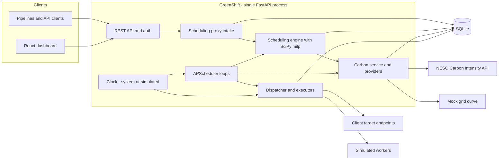
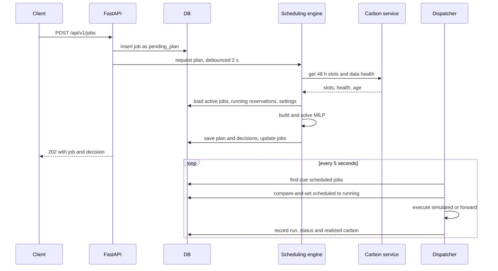

# AI-Driven Smart Energy Load Optimizer for Cloud Infrastructure

*Product Requirements Document · Codename **GreenShift** · v1.0 · 14 October 2026*

| Field | Value |
| --- | --- |
| Product | GreenShift: a carbon-aware job scheduling proxy |
| Sustainable Development Goal | SDG 13, Climate Action |
| Version / status | 1.0 / Implementation-ready |
| Primary readers | Antigravity (prototype generation); hackathon team (build, demo, judging) |
| Core stack | Python 3.12, FastAPI, SciPy (`milp`, `linprog`), SQLite, React + Vite + TypeScript |
| Grid data | NESO Carbon Intensity API (Great Britain), with a mock provider and cached fallback |

**Reading guide for code generation.** Sections 8 to 12 are the build contract (architecture, algorithm, schema, API). Section 13 is the UI contract. If two sections ever appear to differ, the database schema (11) and API contract (12) win. Every decision in this document is final. No choice is left open and nothing should be asked back.

## Table of Contents

1. Executive Summary
2. Problem, Motivation and Proposed Solution
3. Users, Personas, Use Cases and Journeys
4. Goals and Success Metrics
5. Assumptions, Dependencies, Limitations and Scope
6. Feature Specification
7. Functional and Non-Functional Requirements
8. System Architecture
9. Technology Stack and Engineering Decisions
10. Scheduling and Optimization Logic
11. Database Design
12. API Design and Routing
13. UI/UX Design Specification
14. Security, Reliability and Performance
15. Testing Strategy and Acceptance Criteria
16. Implementation and Delivery Plan
17. Documentation and Deployment
18. Risks and Future Improvements
19. Glossary
20. Implementation-Readiness Checklist

---

## 1. Executive Summary

GreenShift is a scheduling proxy that sits between automated pipelines (ML training, rendering, ETL, batch analytics) and the infrastructure that runs them. Instead of executing a heavy job the moment it is requested, clients hand it to GreenShift with a duration, a power estimate and a deadline. GreenShift pulls live and forecast grid carbon intensity, solves a small optimization problem with SciPy's mixed-integer linear programming solver, and starts the job in the cleanest window that still meets its deadline and the cluster's capacity.

The MVP delivers:

- A FastAPI service that accepts jobs, plans them, executes them (simulated or by forwarding a stored HTTP request) and records every decision.
- A carbon data layer built on the NESO Carbon Intensity API, with a deterministic mock provider and cached fallback so the product always works in a demo.
- A React dashboard whose centrepiece is a 48-hour **carbon timeline**: a heatmap of forecast intensity with every scheduled job drawn on top of it.
- Plain-language explanations for every scheduling decision and honest, labelled estimates of avoided emissions.
- A demo mode with an accelerated simulated clock so a full day of scheduling can be shown in about five minutes.

**Important framing.** GreenShift optimizes *grid carbon intensity* (gCO2/kWh). It does not guarantee that jobs run on renewable energy, and it never presents modelled savings as measured savings. See section 2.5.

## 2. Problem, Motivation and Proposed Solution

### 2.1 Problem

Data centers and enterprise clusters draw large amounts of electricity. The carbon cost of a kilowatt-hour changes hour by hour because the generation mix changes: solar and wind output rises and falls while demand peaks push gas and coal onto the grid. Heavy workloads are normally started the moment they are requested, so many of them run when the grid is dirtiest even though they could have waited.

### 2.2 Motivation

A large share of compute is time-flexible: nightly retraining, render farms, reports, backfills, data exports. For these jobs the deadline matters and the exact start time does not. Shifting such work to cleaner hours cuts emissions with no new hardware and no loss of function, which makes it one of the cheapest software-only climate actions available (SDG 13).

### 2.3 Proposed solution

A proxy and scheduler with four responsibilities: **intercept** (accept jobs through one API), **observe** (retrieve and normalize carbon intensity and forecasts), **decide** (optimize start times under deadline, priority and capacity constraints) and **execute and explain** (start jobs on time, track them, and say why each decision was made).

### 2.4 Value proposition

| Stakeholder | Value |
| --- | --- |
| Platform and DevOps teams | One API to defer flexible work safely, with deadline guarantees and no pipeline rewrites |
| ML and data engineers | Deadlines are respected; heavy jobs run cheaper in carbon terms and often at quieter hours |
| Sustainability and management | Auditable estimates of gCO2e avoided, per job and over time |
| Hackathon judges | A working end-to-end system with real data, real optimization and measurable impact |

### 2.5 What GreenShift does not claim

- **Carbon intensity is not renewable availability.** The NESO figure is the average emissions per kWh of the GB grid. Low intensity usually coincides with high wind or solar, but the product optimizes the intensity figure only. The renewable share from the generation-mix endpoint is displayed for context and never used as a constraint.
- **Savings are estimates.** They compare the planned schedule against a counterfactual of running at the earliest possible time, using average (not marginal) intensity. They are labelled *forecast-based* at plan time and *realized* once actual intensity is published.
- **No exclusivity.** If no cleaner window exists before a deadline, the job runs when it must. GreenShift never promises that work runs only at renewable peaks.

## 3. Users, Personas, Use Cases and Journeys

### 3.1 Personas

| Persona | Role | Goals | Frustrations |
| --- | --- | --- | --- |
| **Priya Nair** | Platform engineer, owns the compute cluster and pipeline integrations | Reduce cluster carbon without breaking SLAs; integrate with a single API call | Pipelines that fire at peak hours; no visibility into why things run when they do |
| **Marcus Webb** | ML engineer submitting training and batch jobs | Get results by a known deadline; avoid babysitting schedules | Opaque delays; fear that a scheduler will make him miss a deadline |
| **Dana Okafor** | Sustainability lead | Credible, exportable numbers for reporting | Marketing-grade claims with no method behind them |

Priya is the admin user. Marcus is an API client and a viewer. Dana is a viewer.

### 3.2 Core use cases

| ID | Use case | Primary actor |
| --- | --- | --- |
| UC1 | Submit a flexible job with a deadline and receive a planned start time | Marcus (API) |
| UC2 | Submit a non-deferrable job that must run immediately | Marcus |
| UC3 | See the current grid state and the next 48 hours of forecast intensity | Priya, Dana |
| UC4 | Inspect why a job was delayed or run now | Marcus, Priya |
| UC5 | Cancel, retry or run a job immediately | Priya, Marcus |
| UC6 | Tune capacity, delay limits and weights | Priya |
| UC7 | Review historical savings and export them | Dana |
| UC8 | Keep operating when the carbon API is slow or down | Priya |
| UC9 | Preview a recommended window before submitting | Marcus |
| UC10 | Run a scripted accelerated demo | Hackathon team |

### 3.3 User journeys

**J1: Submit, plan, run.** Marcus posts a 3-hour training job due at 06:00. GreenShift responds 202 with a planned start at 02:00 UTC and the text: 'Delayed 6 h 30 min to a window averaging 92 gCO2/kWh instead of 241 (-62%). Deadline met with 3 h of slack.' At 02:00 the job starts, shows progress, and completes. The job page shows forecast savings, later updated with realized savings.

**J2: Reporting.** Dana opens Analytics, selects the last 7 days, sees estimated gCO2e avoided, share of jobs shifted, on-time rate and average delay, and downloads a CSV.

**J3: Degraded data.** The carbon API times out. A banner appears ('Using cached forecast, 2 h old'). Scheduling continues on cached data. After 6 hours without data the system switches to a deadline-first fail-safe and says so on every affected decision.

## 4. Goals and Success Metrics

**Product goals.** G1: reduce estimated emissions of flexible workloads. G2: never trade a missed deadline for carbon savings. G3: make every decision explainable. G4: be demonstrable end to end with no paid services.

| Metric | Definition | MVP target |
| --- | --- | --- |
| Estimated emissions reduction | (baseline gCO2e - scheduled gCO2e) / baseline gCO2e across deferrable jobs; baseline is run at earliest possible start | At least 20% on the seeded demo scenario; reported as measured on live data, with no promise |
| On-time completion | Jobs finished by deadline / jobs with deadline | At least 99% when capacity is feasible |
| Decision latency | Submission to first planned start | p95 under 3 s for up to 200 active jobs |
| Decision coverage | Decisions that carry an explanation | 100% |
| Data freshness | Share of planning runs using carbon data under 90 min old | At least 95% in live mode |
| Time to demo | Clean clone to running demo | Under 10 minutes with one command |

## 5. Assumptions, Dependencies, Limitations and Scope

### 5.1 Assumptions

- Submitted jobs are non-preemptible and run contiguously on a shared pool of compute units.
- Clients give honest duration and power estimates; GreenShift supplies defaults per workload type.
- All internal times are UTC. The grid-intensity zone is Great Britain unless a different provider is configured.

### 5.2 Dependencies and fallbacks

| Dependency | Needed for | Credentials | Fallback |
| --- | --- | --- | --- |
| NESO Carbon Intensity API (api.carbonintensity.org.uk) | Live and 48 h forecast intensity, generation mix | None required, no key | Cached data up to 6 h old, then deadline-first fail-safe |
| Mock carbon provider (built in) | Demo mode, tests, offline use | None | Not applicable |
| Optional: Electricity Maps adapter | Other regions | Paid or limited token | Interface stubbed, disabled by default |
| Target URLs in forward mode | Executing proxied requests | Provided by the client | Job fails with recorded error and retries |

The NESO API covers Great Britain only. There is no equivalent free, keyless source for every country, so the demo uses GB data by design and says so in the UI.

### 5.3 Limitations

- Forecast horizon is 48 hours, so decisions are planned within that window and re-planned as the horizon rolls forward.
- Intensity is the grid average, not marginal emissions; embodied carbon is excluded.
- Execution is simulated unless forward mode is used. GreenShift does not launch containers or VMs in the MVP.
- Single tenant, single process, SQLite. Horizontal scaling is a documented future path.

### 5.4 Out of scope for the MVP

Pre-emptible or splittable jobs, multi-region migration, Kubernetes integration, real cloud billing data, multi-tenant organizations, SSO, ML-based forecasting, native mobile apps, webhooks to external notifiers, and price-based optimization.

## 6. Feature Specification

| ID | Feature | Tier |
| --- | --- | --- |
| F1 | Job submission and registration (scheduling proxy ingestion) | MVP |
| F2 | Job metadata, resource model and validation | MVP |
| F3 | Carbon data retrieval and normalization | MVP |
| F4 | Scheduling engine and optimization | MVP |
| F5 | Queue management and execution tracking | MVP |
| F6 | Scheduling decisions and explanations | MVP |
| F7 | Manual controls and configuration | MVP |
| F8 | Error handling, retries and fallback | MVP |
| F9 | History, carbon estimates and analytics | MVP |
| F10 | Authentication and API keys | MVP |
| F11 | Demo mode: simulated clock, mock grid, scenarios | MVP |
| F12 | Schedule preview (what-if) | MVP |
| F13 | Splittable and checkpointable jobs | Future |
| F14 | Multi-region placement | Future |

### F1. Job Submission and Registration

**Purpose.** One entry point where automated pipelines hand over work. **Behavior.** `POST /api/v1/jobs` validates the request, stores the job as `pending_plan`, triggers a debounced re-plan, waits up to 3 s for the first decision, and returns `202 Accepted` with the job (and its decision if ready). Two execution modes: `simulated` (default) and `forward`, the true proxy mode in which GreenShift stores the client's intended HTTP request and replays it at the planned start time, recording the response status. Idempotent via `Idempotency-Key` header. **Inputs.** Job spec (F2). **Outputs.** Job resource with `status`, `planned_start_at` and `decision` when available. **Validation.** Per F2, plus forward-mode target rules: HTTPS only (HTTP allowed only if `ALLOW_HTTP_TARGETS=true`), host must match `FORWARD_ALLOWED_HOSTS` when set, private, loopback and link-local addresses rejected, body at most 64 KB, at most 20 headers. **Depends on.** F2, F4, F10. **Acceptance.**

- AC1: valid request returns 202 in under 500 ms when not waiting for a plan; with the 3 s wait the decision is included in at least 95% of cases at 50 active jobs.
- AC2: a repeated `Idempotency-Key` returns the original job with 200 and creates no row.
- AC3: invalid input returns 422 listing every failing field.
- AC4: a forward target resolving to a private address is rejected with code `TARGET_NOT_ALLOWED`.

### F2. Job Metadata, Resource Model and Validation

**Purpose.** Capture exactly what the scheduler needs. **Fields.** `name`, `description`, `workload_type` (`ml_training`, `video_rendering`, `data_processing`, `batch_etl`, `generic`), `priority` (`low`, `normal`, `high`), `deferrable` (bool, default true), `duration_minutes`, `resource_units`, `power_kw` (optional), `earliest_start_at` (optional), `deadline_at` (required when `deferrable=true`), `execution` (mode and optional target). **Defaults.** If `power_kw` is absent: `resource_units x watts_per_unit(workload_type) / 1000`, with watts per unit of 300, 200, 120, 80 and 100 for the five types in the order listed. Energy is multiplied by the configured PUE (default 1.4). **Validation.** `name` 3 to 120 characters; `duration_minutes` integer 5 to 1440; `resource_units` integer 1 to the cluster capacity; `power_kw` 0.01 to 500; `earliest_start_at` defaults to now and may not be in the past by more than 5 minutes; `deadline_at` must be at least `earliest_start_at + duration` and at most 7 days ahead; non-deferrable jobs ignore the deadline. **Acceptance.** AC1: each rule has a negative test returning 422 with a field-level message. AC2: defaults applied are echoed back in the response.

### F3. Carbon Data Retrieval and Normalization

**Purpose.** Provide a uniform, trustworthy intensity series to the scheduler. **Behavior.** A `CarbonProvider` interface returns `Slot(period_start, period_end, forecast_gco2_kwh, actual_gco2_kwh|null, index_label)` for 30-minute periods. The live provider calls `GET /intensity` (now), `GET /intensity/{from}/fw48h` (48 h forecast), `GET /intensity/{from}/{to}` (history) and `GET /generation` (mix), parsing `forecast`, `actual` and `index`. Data refreshes every 15 minutes, is upserted into `carbon_observations`, and is aligned to :00 and :30 UTC. Gaps up to 3 slots are filled by linear interpolation and flagged `interpolated`; larger gaps use the value from the same slot 24 h earlier if present. Timeouts: 5 s connect and read, 3 retries with exponential backoff and jitter. **Outputs.** Normalized series, health status (`ok`, `degraded`, `unavailable`), age of the newest successful fetch. **Acceptance.** AC1: parsing is verified against recorded fixtures of the real response shape. AC2: after three consecutive failures status becomes `degraded` and the last good forecast is used. AC3: UI shows data age and provider name on every grid view.

### F4. Scheduling Engine and Optimization

**Purpose.** Choose start times that minimize carbon subject to constraints. **Behavior.** Triggered by job submit, cancel, completion, new forecast, settings change, and a 15-minute heartbeat. Builds a time-indexed mixed-integer linear program over 30-minute slots, solves it with `scipy.optimize.milp` (HiGHS) with a 5 s time limit, and writes a `schedule_plan` and one `scheduling_decision` per job. Full formulation in section 10. **Guarantees.** Hard constraints (deadline, capacity, earliest start, max delay cap) are never violated by a returned plan; if they cannot all be met, the affected job is flagged `deadline_infeasible` and scheduled best-effort. **Acceptance.** AC1: on a fixture with one trough, a flexible job starts in the trough. AC2: no plan ever exceeds capacity in any slot (property-tested). AC3: a job with deadline equal to earliest finish starts immediately. AC4: re-planning with unchanged inputs yields an identical plan.

### F5. Queue Management and Execution Tracking

**Purpose.** Run jobs when planned and show their state. **Behavior.** A dispatcher ticks every 5 s (real time). Any `scheduled` job whose `planned_start_at` has passed is atomically moved to `running` (compare-and-set) and handed to its executor. `SimulatedExecutor` derives progress from the clock; `ForwardExecutor` sends the stored request, treating 2xx as success. States: `pending_plan`, `scheduled`, `running`, `retry_wait`, `succeeded`, `failed`, `cancelled`. Transitions are in section 11.4. **Acceptance.** AC1: only one dispatcher ever starts a given job. AC2: a job passes through states in legal order and every transition writes a `job_events` row. AC3: after a server restart, `running` jobs are reconciled (simulated ones resume from the clock; forward ones are marked `failed` with reason `INTERRUPTED` and retried).

### F6. Scheduling Decisions and Explanations

**Purpose.** Make every decision transparent. **Behavior.** Each decision stores a `reason_code` and a human-readable explanation generated from deterministic templates (no LLM): planned start, delay, expected vs baseline average intensity, estimated gCO2e saved, slack to deadline, and whether data was degraded. Reason codes: `CLEANER_WINDOW`, `RUN_NOW_NO_BETTER_WINDOW`, `NON_DEFERRABLE`, `DEADLINE_CONSTRAINED`, `CAPACITY_CONSTRAINED`, `MAX_DELAY_CAP`, `DEGRADED_DATA_FALLBACK`, `DEADLINE_INFEASIBLE`, `MANUAL_OVERRIDE`. **Acceptance.** AC1: 100% of decisions include code and text. AC2: the numbers in the text equal the stored numeric fields. AC3: superseded decisions are kept with `is_current=false` as history.

### F7. Manual Controls and Configuration

**Controls.** Cancel (scheduled or retry\_wait), Run now (if capacity allows, else 409 `NO_CAPACITY` with next feasible time), Retry (failed jobs), Replan all. **Settings (admin only).** `capacity_units` (default 16), `pue` (1.4), `max_delay_hours` (24), `lambda_low/normal/high` (1, 2, 6 gCO2/kWh per hour), `stickiness_gco2` (5), `stale_after_minutes` (90), `fallback_policy` (`asap`), `carbon_provider` (`neso` or `mock`), `zone_label`. **Acceptance.** AC1: changed settings take effect on the next plan and trigger one. AC2: invalid values return 422. AC3: every change is audited with user and timestamp.

### F8. Error Handling, Retries and Fallback

**Behavior.** Forward-mode failures retry up to 3 times with delays of 30 s, 2 min and 10 min (simulated clock aware), then become `failed`. Solver failure falls back to a greedy lowest-carbon-feasible-window heuristic, then to earliest-deadline-first ASAP. Carbon outage follows the staleness ladder in 10.7. All errors use the standard error body (12.2). **Acceptance.** AC1: forced solver failure still yields a valid plan with `solver=greedy`. AC2: 6 h carbon outage switches to fail-safe and shows a banner. AC3: no unhandled exception ever returns a 500 without a `request_id`.

### F9. History, Carbon Estimates and Analytics

**Behavior.** Per job: baseline gCO2e, planned gCO2e, and realized gCO2e once actual intensity exists. Aggregates by day and by workload type or priority: jobs, avoided gCO2e, percent reduction, average delay, on-time rate, share shifted. CSV export. **Acceptance.** AC1: aggregate figures equal the sum of per-job figures. AC2: estimates are labelled *forecast-based* or *realized* everywhere. AC3: export opens in a spreadsheet and matches the screen.

### F10. Authentication and API Keys

JWT login for the UI (8 h expiry), hashed API keys (`X-API-Key`) for machines, roles `admin` and `viewer`. Viewers may read everything and submit and cancel their own jobs; only admins change settings or manage keys. `AUTH_ENABLED=false` is allowed only when `DEMO_MODE=true`. **Acceptance.** AC1: protected routes return 401 without credentials and 403 for insufficient role. AC2: key plaintext is shown once at creation and never stored.

### F11. Demo Mode

**Purpose.** Show a day of scheduling in minutes, with no external dependency. **Behavior.** `DEMO_MODE=true` enables a `SimulatedClock` (speed 1x to 3600x, default 600x, so 10 minutes real is about 4 days simulated is too fast; default is 120x: two simulated hours per real minute), a deterministic mock carbon curve (overnight wind trough, midday solar dip, evening peak, light noise), seeded jobs, one-click scenarios, and a reset. The UI shows a persistent 'DEMO: simulated clock' chip. **Acceptance.** AC1: `make demo` brings up a populated system. AC2: scenario 'Overnight batch' reproduces the same plan every run. AC3: demo endpoints return 404 when `DEMO_MODE=false`.

### F12. Schedule Preview

`POST /api/v1/schedule/preview` takes a job spec and returns the best window, expected intensity, baseline, saving and top 3 alternative windows without creating a job. It powers the submission form's live recommendation. **Acceptance.** AC1: preview never writes to the database. AC2: the preview window matches what submission then schedules when nothing else changes.

## 7. Functional and Non-Functional Requirements

### 7.1 Functional requirements

| ID | Requirement | Feature | Priority |
| --- | --- | --- | --- |
| FR-01 | The system shall accept job submissions via REST and persist them before acknowledging | F1 | Must |
| FR-02 | The system shall support idempotent submission via `Idempotency-Key` | F1 | Must |
| FR-03 | The system shall support `simulated` and `forward` execution modes | F1, F5 | Must |
| FR-04 | The system shall validate all job fields per F2 and reject unsafe forward targets | F1, F2 | Must |
| FR-05 | The system shall fetch, normalize, store and expose 30-minute carbon intensity data and a 48 h forecast | F3 | Must |
| FR-06 | The system shall expose data health (`ok`, `degraded`, `unavailable`) and data age | F3 | Must |
| FR-07 | The system shall compute a plan with `scipy.optimize.milp` that minimizes carbon plus delay penalty | F4 | Must |
| FR-08 | The system shall never return a plan that violates deadline, capacity, earliest start or delay cap, except by flagging `deadline_infeasible` | F4 | Must |
| FR-09 | The system shall re-plan on submit, cancel, completion, new forecast, settings change and a 15-minute heartbeat | F4 | Must |
| FR-10 | The system shall dispatch due jobs exactly once | F5 | Must |
| FR-11 | The system shall track every state transition as an audit event | F5 | Must |
| FR-12 | The system shall store a reason code and explanation for every decision | F6 | Must |
| FR-13 | The system shall allow cancel, run now, retry and replan-all | F7 | Must |
| FR-14 | The system shall let admins change scheduling settings with validation and audit | F7, F10 | Must |
| FR-15 | The system shall retry failed forward executions up to 3 times with backoff | F8 | Must |
| FR-16 | The system shall fall back from MILP to greedy to ASAP without producing an invalid plan | F8 | Must |
| FR-17 | The system shall compute baseline, planned and realized gCO2e per job and aggregate them | F9 | Must |
| FR-18 | The system shall export analytics as CSV | F9 | Should |
| FR-19 | The system shall authenticate users (JWT) and clients (API key) with admin and viewer roles | F10 | Must |
| FR-20 | The system shall provide a demo mode with simulated clock, mock grid, seeded data and scenarios | F11 | Must |
| FR-21 | The system shall provide a side-effect-free schedule preview | F12 | Should |
| FR-22 | The system shall expose `/healthz` and `/readyz` | all | Must |

### 7.2 Non-functional requirements

| ID | Category | Requirement |
| --- | --- | --- |
| NFR-01 | Performance | A plan for 200 active jobs over 96 slots completes in under 5 s (solver time limit) with p95 API latency under 200 ms for non-planning routes |
| NFR-02 | Performance | Dashboard first contentful render under 2 s on a mid-range laptop over local network |
| NFR-03 | Reliability | The system remains usable with the carbon API unreachable; no request returns 500 because of a provider failure |
| NFR-04 | Reliability | Job state is consistent after a restart; no job is dispatched twice or lost |
| NFR-05 | Security | All inputs validated by Pydantic; secrets only in environment variables; stored target headers encrypted at rest |
| NFR-06 | Security | Rate limiting on all routes; stricter on submission and login |
| NFR-07 | Usability | Every screen has defined loading, empty, error and success states; WCAG 2.1 AA contrast and full keyboard navigation |
| NFR-08 | Usability | Color is never the only carrier of meaning; intensity bands also carry text labels |
| NFR-09 | Observability | Structured JSON logs with `request_id`; every plan logs solver, status, objective and duration |
| NFR-10 | Portability | Runs with `docker compose up` or natively with Python 3.12 and Node 20; no paid services |
| NFR-11 | Maintainability | Type hints everywhere, ruff and mypy clean, at least 80% backend line coverage on `scheduling` and `carbon` packages |
| NFR-12 | Determinism | Given identical inputs and settings, planning produces identical output (fixed tie-breaking by job id) |
| NFR-13 | Time handling | All timestamps stored and transmitted as UTC ISO-8601; the UI renders in the viewer's local zone with a UTC toggle |

---

## 8. System Architecture

### 8.1 Overview

GreenShift is a modular monolith: one FastAPI process hosting the API, the intake layer, the scheduling engine, the carbon service, the dispatcher and the background scheduler, backed by one SQLite database. A React single-page app talks to it over REST. The monolith is deliberate: a hackathon-scale product gains nothing from distributed components, and every module boundary below is also an interface that can be split out later.

### 8.2 Request lifecycle

### 8.3 Components

| Component | Responsibility | Backend module |
| --- | --- | --- |
| REST API and auth | Routing, serialization, JWT and API-key auth, rate limiting, error envelope | `app/api/`, `app/core/security.py` |
| Scheduling proxy intake | Validation, SSRF checks, idempotency, persistence, plan trigger | `app/services/intake.py` |
| Queue and scheduling engine | Builds the optimization problem from DB state and forecast, solves, stores plan and decisions, generates explanations | `app/scheduling/` (`model.py`, `solver.py`, `greedy.py`, `explain.py`, `planner.py`) |
| Carbon service | Provider abstraction, normalization, interpolation, caching, health status | `app/carbon/` (`base.py`, `neso.py`, `mock.py`, `service.py`) |
| Optimization engine | Pure functions over NumPy and SciPy; no I/O, so fully unit-testable | `app/scheduling/solver.py` |
| Persistence | SQLAlchemy models, repositories, Alembic migrations | `app/db/` |
| Dispatcher and executors | Due-job detection, compare-and-set start, `SimulatedExecutor`, `ForwardExecutor`, retries | `app/execution/` |
| Background processing | APScheduler loops: carbon refresh (15 min), dispatch tick (5 s), heartbeat re-plan (15 min), retention cleanup (daily) | `app/core/background.py` |
| Clock | `SystemClock` and `SimulatedClock(speed, anchor)`; every time read goes through it | `app/core/clock.py` |
| Logging and errors | structlog JSON, `request_id` middleware, exception handlers | `app/core/logging.py`, `app/core/errors.py` |
| Frontend | React SPA, API client, charts | `frontend/src/` |

### 8.4 Scheduling proxy versus execution environment

- The **scheduling proxy** (control plane) is everything GreenShift owns: intake, planning, decisions, state and audit. It never needs credentials for a cloud provider.
- The **execution environment** (data plane) is whatever actually performs the work. It sits behind the `Executor` interface: `SimulatedExecutor` (MVP default, no external effect) and `ForwardExecutor` (replays the client's stored HTTP request to its own endpoint). A `KubernetesExecutor` or cloud-batch executor is a future implementation of the same interface.
- **Demonstrating without production infrastructure.** Demo mode uses the simulated executor, the mock carbon provider and the simulated clock. For a live-data demo, only the carbon provider is switched to NESO. For a proxy demo, a tiny bundled echo service (`demo/echo_target.py`, FastAPI, one route) receives forwarded requests and shows they arrived at the planned time.

### 8.5 Architectural decisions

| Decision | Choice | Rationale |
| --- | --- | --- |
| Deployment shape | Modular monolith, one process | Lowest operational burden; clean module seams |
| Job queue | The `jobs` table is the queue; APScheduler drives the dispatcher | No Redis or Celery to run; state is transactional and inspectable |
| Optimizer | `scipy.optimize.milp` primary; `linprog` for the LP lower bound; greedy and ASAP fallbacks | Contiguous non-preemptible jobs need integrality; HiGHS is fast at this size; the lower bound reports plan quality |
| Explanations | Deterministic templates | Reproducible, auditable, no API cost or hallucination risk |
| Live updates | Client polling (5 s) through TanStack Query | Simple and robust; SSE is a documented future step |
| Time | A `Clock` abstraction everywhere | Makes accelerated demos and deterministic tests possible |
| Single planner | One in-process lock around planning | Prevents conflicting plans; SQLite has one writer anyway |

### 8.6 Logging, monitoring and error handling

Structured JSON logs (`ts`, `level`, `event`, `request_id`, `job_id`, `plan_id`). Each plan logs solver, solver status, objective, LP bound, gap, variables, duration. `/readyz` checks the database, the background scheduler heartbeat and carbon-provider health. The System panel in the UI shows the same data. Unhandled exceptions are caught by a global handler returning the standard error body with a `request_id` and logging the stack trace.

---

## 9. Technology Stack and Engineering Decisions

| Layer | Selection | Why it suits the MVP |
| --- | --- | --- |
| Language and runtime | Python 3.12 | Required stack; best SciPy support |
| Web framework | FastAPI (0.110 or newer), Uvicorn | Required stack; typed schemas and automatic OpenAPI docs |
| Validation | Pydantic v2 | Same models drive validation, docs and tests |
| Optimization | SciPy 1.11 or newer (`milp`, `linprog`, `LinearConstraint`, `Bounds`), NumPy, `scipy.sparse` | `milp` provides integer programming through HiGHS; sparse matrices keep 20k-variable models fast |
| HTTP client | httpx (async) with tenacity-style backoff | Timeouts, retries and test mocking via respx |
| Database | SQLite in WAL mode, via SQLAlchemy 2.0 and Alembic | Zero setup, file-based, transactional. Schema is Postgres-compatible; switching is one `DATABASE_URL` change |
| Background jobs | APScheduler (AsyncIOScheduler) in process | No broker needed; sufficient for 5 s and 15 min cadences |
| Authentication | PyJWT (HS256) for UI sessions, hashed API keys for machines, argon2-cffi for passwords | Proportional to a single-tenant MVP |
| Rate limiting | slowapi | Simple per-key and per-IP limits |
| Logging | structlog | JSON logs with context binding |
| Frontend | React 18, Vite, TypeScript | Fast dev loop; strong ecosystem for charts and forms |
| Styling | Tailwind CSS with CSS-variable design tokens; Radix-based primitives (shadcn/ui pattern); lucide-react icons | Consistent system, accessible primitives, dark mode through tokens |
| Data fetching | TanStack Query v5 | Caching, polling, retries, loading and error states for free |
| Routing | React Router v6 | Standard |
| Forms | react-hook-form with zod | Client validation mirrors server rules |
| Charts | Custom SVG for the carbon timeline; Recharts for line, area and bar charts | The timeline is the product's signature view and needs control; Recharts handles the rest |
| Backend tests | pytest, pytest-asyncio, respx, hypothesis | Unit, integration, mocked external API, property tests for the optimizer |
| Frontend tests | Vitest, Testing Library, Playwright | Component and end-to-end coverage |
| Quality | ruff, mypy, ESLint, Prettier | Consistent code |
| Packaging and deploy | Docker, Docker Compose, nginx serving the built SPA and proxying `/api`; GitHub Actions CI | One command to run anywhere |
| External carbon API | NESO Carbon Intensity API, `https://api.carbonintensity.org.uk`, no key | Free, keyless, half-hourly, 48 h forecast, generation mix, openly licensed |

**Alternatives considered only where the trade-off matters.** Postgres is the right choice beyond one node, and the schema is ready for it. Celery or RQ with Redis would be warranted for multiple workers. Electricity Maps covers more countries but requires a token and has usage limits, so it ships only as a disabled adapter. LLM-generated explanations were rejected for reproducibility.
