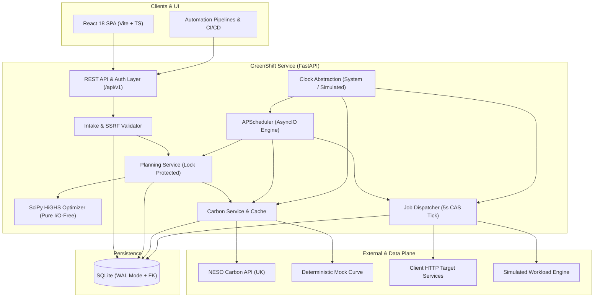
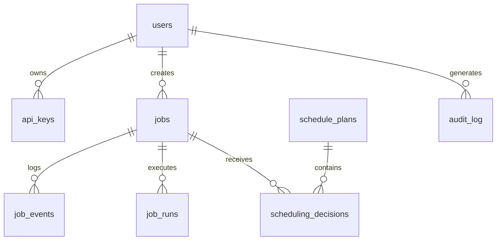
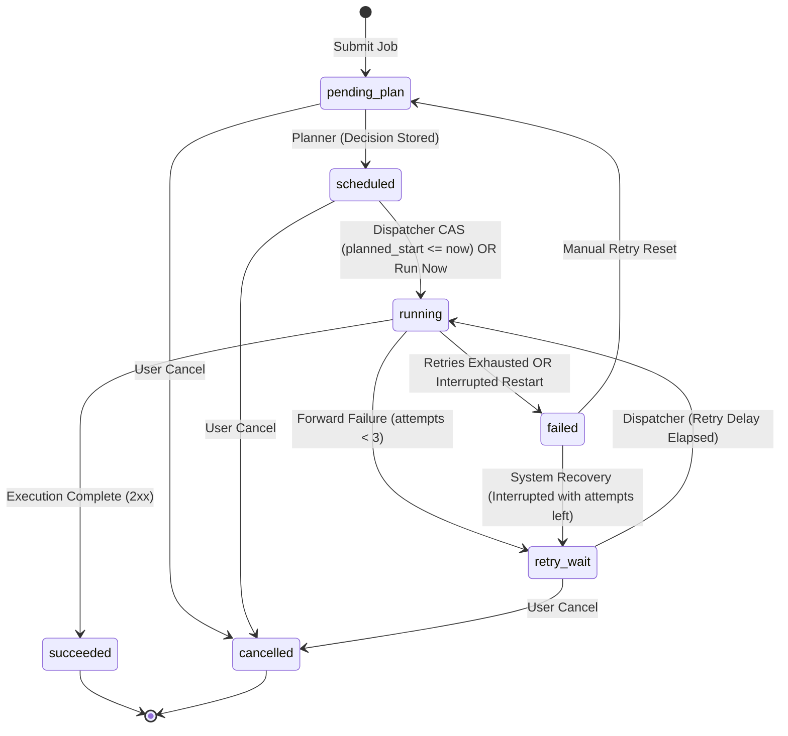

# AI-Driven Smart Energy Load Optimizer for Cloud Infrastructure

*Product Requirements Document · Codename **GreenShift** (Project **EcoThrottle**) · v1.1 · 14 October 2026*

| Field | Value |
| --- | --- |
| Product | GreenShift: a carbon-aware job scheduling proxy |
| Repository / Project | EcoThrottle (`the-fahyan/EcoThrottle`) |
| Sustainable Development Goal | SDG 13, Climate Action |
| Version / status | 1.1 / Implementation-ready (Full 20 Sections Complete) |
| Primary readers | Antigravity (prototype & production generation); hackathon team & engineers |
| Core stack | Python 3.12, FastAPI, SciPy (`milp`, `linprog`), SQLAlchemy 2.0, SQLite (WAL), React 18, Vite, TypeScript, Tailwind CSS |
| Grid data | NESO Carbon Intensity API (Great Britain), with deterministic mock provider and cached fallback |

**Reading guide for code generation.** Sections 8 to 12 are the build contract (architecture, algorithm, schema, API). Section 13 is the UI contract. If two sections ever appear to differ, the database schema (§11) and API contract (§12) win. Every decision in this document is final, internally consistent, and actionable.

## Table of Contents

1. [Executive Summary](#1-executive-summary)
2. [Problem, Motivation and Proposed Solution](#2-problem-motivation-and-proposed-solution)
3. [Users, Personas, Use Cases and Journeys](#3-users-personas-use-cases-and-journeys)
4. [Goals and Success Metrics](#4-goals-and-success-metrics)
5. [Assumptions, Dependencies, Limitations and Scope](#5-assumptions-dependencies-limitations-and-scope)
6. [Feature Specification](#6-feature-specification)
7. [Functional and Non-Functional Requirements](#7-functional-and-non-functional-requirements)
8. [System Architecture](#8-system-architecture)
9. [Technology Stack and Engineering Decisions](#9-technology-stack-and-engineering-decisions)
10. [Scheduling and Optimization Logic](#10-scheduling-and-optimization-logic)
11. [Database Design](#11-database-design)
12. [API Design and Routing](#12-api-design-and-routing)
13. [UI/UX Design Specification](#13-uiux-design-specification)
14. [Security, Reliability and Performance](#14-security-reliability-and-performance)
15. [Testing Strategy and Acceptance Criteria](#15-testing-strategy-and-acceptance-criteria)
16. [Implementation and Delivery Plan](#16-implementation-and-delivery-plan)
17. [Documentation and Deployment](#17-documentation-and-deployment)
18. [Risks and Future Improvements](#18-risks-and-future-improvements)
19. [Glossary](#19-glossary)
20. [Implementation-Readiness Checklist](#20-implementation-readiness-checklist)

---

## 1. Executive Summary

GreenShift (developed under the EcoThrottle project) is an intelligent scheduling proxy that sits between automated compute pipelines (ML training, video rendering, ETL, batch analytics) and the infrastructure that executes them. Instead of executing heavy compute jobs the moment they are requested, client pipelines submit them to GreenShift with an estimated duration, resource requirements, power profile, and a completion deadline. GreenShift pulls live and 48-hour forecast grid carbon intensity data, solves a mixed-integer linear programming (MILP) problem via SciPy's HiGHS solver, and dispatches the job in the cleanest grid window that satisfies deadline, priority, and cluster capacity constraints.

The MVP delivers:
- A high-performance **FastAPI service** that accepts jobs, optimizes placement, dispatches execution (simulated or via HTTP request forwarding), and records audit trails.
- A **carbon data abstraction layer** built on the UK NESO Carbon Intensity API, accompanied by a deterministic mock provider and resilient multi-tier caching.
- A modern **React + Vite + TypeScript dashboard** featuring a signature 48-hour **carbon timeline heatmap** displaying forecast carbon intensity with scheduled workloads overlaid.
- **Deterministic, auditable explanations** for every scheduling decision, paired with honest, labelled estimates of counterfactual avoided emissions.
- A turnkey **demo mode** featuring an accelerated simulated clock (default 120x, configurable up to 3600x with a 288x "day-in-5-minutes" preset) enabling end-to-end evaluation in minutes without cloud costs.

**Framing and Integrity.** GreenShift optimizes *grid carbon intensity* (gCO2/kWh). It does not guarantee that jobs run exclusively on renewable energy, and it never presents modelled estimates as measured counterfactuals.

---

## 2. Problem, Motivation and Proposed Solution

### 2.1 Problem
Cloud data centers and enterprise clusters consume vast electrical power. Grid carbon intensity fluctuates hourly based on the energy generation mix: solar and wind surge and abate, while peak demand requires firing fossil peaker plants (gas and coal). Standard workload orchestrators execute jobs immediately upon arrival, frequently running compute-intensive workloads during peak grid dirtiness even when jobs could have waited hours with zero operational penalty.

### 2.2 Motivation
A substantial portion of compute workloads is time-flexible: nightly model retraining, batch video rendering, scheduled ETL pipelines, database backfills, and reporting queries. For these workloads, the deadline is strict, but the exact start time is flexible. Intelligently shifting flexible compute to clean grid windows reduces greenhouse gas emissions with zero hardware expenditure and no SLA degradation, directly advancing UN Sustainable Development Goal 13 (Climate Action).

### 2.3 Proposed Solution
GreenShift acts as a proxy and scheduling brain with four core responsibilities:
1. **Intercept:** Ingest jobs through a clean REST API supporting simulated execution and forward-proxy execution.
2. **Observe:** Retrieve, normalize, interpolate, and cache 30-minute grid carbon intensity forecasts.
3. **Decide:** Solve a time-indexed mixed-integer linear program to schedule jobs in optimal carbon windows subject to deadlines, resource caps, and priority-weighted delay penalties.
4. **Execute and Explain:** Dispatch jobs exactly once when their window arrives, track execution outcomes, and generate clear, deterministic explanations for every decision.

### 2.4 Value Proposition
| Stakeholder | Value |
| --- | --- |
| Platform & DevOps Teams | Drop-in scheduling proxy to decarbonize batch compute with SLA guarantees and zero pipeline rewrites. |
| ML & Data Engineers | Reliable deadline adherence; jobs run cheaper in carbon footprint and avoid peak congestion windows. |
| Sustainability Leads | Transparent, auditable, and exportable metrics of avoided gCO2e per job and across the organization. |
| Hackathon Judges & Evaluators | Turnkey, zero-dependency runnable system with real-world open data, rigorous mathematics, and measurable impact. |

### 2.5 What GreenShift Does Not Claim
- **Carbon intensity is not 100% renewable exclusivity:** NESO data represents average grid emissions per kWh in Great Britain. Low intensity correlates with high wind/solar, but GreenShift optimizes gCO2/kWh average intensity.
- **Savings are modelled counterfactual estimates:** Savings compare the optimized schedule against an immediate-execution baseline at earliest arrival. All figures are explicitly labelled *forecast-based* at plan time and *realized* once actual historical intensity is recorded.
- **Hard SLA priority over greenness:** GreenShift will never miss a deadline to chase cleaner energy. If no clean window exists before a deadline, the job runs immediately.

---

## 3. Users, Personas, Use Cases and Journeys

### 3.1 Personas
- **Priya Nair (Platform Engineer - Admin):** Manages compute infrastructure and pipeline integration. Needs safe job deferrals without breaking SLAs, configurable cluster capacity, and transparent system health monitoring.
- **Marcus Webb (ML Engineer - API Client / Viewer):** Submits batch training and ETL jobs. Demands deterministic deadline guarantees, wants to see why jobs were deferred, and previews recommended windows before submission.
- **Dana Okafor (Sustainability Lead - Viewer):** Requires credible, exportable carbon accounting numbers to verify emissions reduction claims for corporate reporting.

### 3.2 Core Use Cases
- **UC1:** Submit flexible job with deadline and receive planned schedule (`POST /api/v1/jobs`).
- **UC2:** Submit non-deferrable job that must run immediately with capacity reservation.
- **UC3:** Inspect current grid intensity, generation mix, and 48-hour forecast timeline.
- **UC4:** View deterministic explanation and metrics for a job's scheduling decision.
- **UC5:** Operator controls: Cancel scheduled jobs, trigger immediate run, retry failed jobs.
- **UC6:** Configure cluster capacity, delay penalties, PUE, and carbon provider settings.
- **UC7:** Review aggregated carbon analytics and export auditable CSV reports.
- **UC8:** Automatic graceful degradation during external carbon API outages.
- **UC9:** Preview recommended carbon window before job submission (what-if analysis).
- **UC10:** Execute scripted, accelerated demo scenarios across a simulated day.

### 3.3 User Journeys
- **J1 (Submit, Plan, Run):** Marcus submits a 3-hour ML training job due in 12 hours. GreenShift returns HTTP 202 with a planned start at 02:00 UTC and explanation: *"Delayed 6 h 00 min to a window averaging 88 gCO2/kWh instead of 245 (-64%). Deadline met with 3 h slack."* At 02:00 UTC, the dispatcher moves the job to running and records completion.
- **J2 (Sustainability Reporting):** Dana opens the Analytics dashboard, filters the last 7 days, verifies avoided gCO2e, on-time completion rate, and downloads an audit-compliant CSV report.
- **J3 (Degraded Grid Data Recovery):** NESO API times out. System raises a persistent UI warning banner (*"Using cached forecast, 2 h old"*). Scheduling continues uninterrupted. If outage exceeds 6 hours, system safely shifts to fail-safe ASAP scheduling and tags all decisions with `DEGRADED_DATA_FALLBACK`.

---

## 4. Goals and Success Metrics

### 4.1 Product Goals
- **G1:** Measurably reduce carbon emissions of time-flexible compute workloads.
- **G2:** Zero deadline violations under feasible capacity constraints.
- **G3:** 100% explainable, deterministic decisions with transparent counterfactual accounting.
- **G4:** Zero-cost, turnkey portability: runnable anywhere in minutes with no cloud subscription.

### 4.2 Measurable Success Metrics
| Metric | Definition | MVP Target |
| --- | --- | --- |
| Carbon Reduction | `(baseline_gco2e - scheduled_gco2e) / baseline_gco2e` for flexible jobs | ≥ 20% on seeded scenario |
| On-Time Completion | Jobs finished by deadline / jobs with feasible deadline | ≥ 99% |
| Decision Latency | Submission to initial returned schedule decision | p95 < 3.0 s (50 active jobs) |
| Non-Planning API Latency | Read and status endpoints | p95 < 200 ms |
| Decision Coverage | Percentage of scheduling decisions with structured explanation | 100% |
| Data Freshness | Share of plans calculated using carbon data < 90 min old | ≥ 95% in live mode |
| Time to Demo | Time from git clone to fully operating demo | < 10 minutes |

---

## 5. Assumptions, Dependencies, Limitations and Scope

### 5.1 Assumptions
- Workloads are non-preemptible and run contiguously on a shared homogeneous pool of compute units (`capacity_units`).
- All internal times are strictly timezone-aware UTC ISO-8601 strings.
- Grid data defaults to Great Britain (NESO API) unless mock or custom provider is selected.

### 5.2 Dependencies and Fallbacks
| Dependency | Purpose | Credentials | Fallback Mechanism |
| --- | --- | --- | --- |
| NESO Carbon API | Live & 48h forecast grid intensity, generation mix | None (free, keyless) | Cached data up to 6h; then deadline-first ASAP fail-safe |
| Mock Carbon Provider | Offline execution, testing, reproducible demos | None | Built-in mathematical model |
| Client Forward Endpoints | Target HTTP endpoints in forward proxy mode | Client-provided | Recorded error, backoff retry (30s, 2m, 10m) |

### 5.3 Limitations
- Planning horizon is 48 hours (96 half-hour slots). Deadlines beyond 48 hours are truncated to the horizon boundary and re-planned dynamically as time rolls forward.
- Single-process modular monolith with SQLite WAL; horizontal distributed worker clustering is out of scope for MVP.

### 5.4 Out of Scope
Pre-emptible/splittable jobs, multi-region dynamic geographic workload migration, native Kubernetes CRD operator, cloud billing integration, multi-tenant RBAC, LLM-based narrative generation, and real-time electricity price bidding.

---

## 6. Feature Specification

| ID | Feature | Tier | Description |
| --- | --- | --- | --- |
| **F1** | Job Submission & Registration | MVP | REST endpoint accepting jobs in simulated or forward proxy mode, with idempotency. |
| **F2** | Workload Metadata & Validation | MVP | Pydantic validation, power defaults per workload type, PUE calculations. |
| **F3** | Carbon Data Ingestion & Normalization | MVP | Multi-provider abstraction, 30-min slot alignment, gap interpolation, health ladder. |
| **F4** | Optimization Engine | MVP | Mixed-integer linear programming via SciPy HiGHS with greedy and ASAP fallbacks. |
| **F5** | Dispatcher & Execution Engine | MVP | 5s dispatch loop, compare-and-set claim, simulated and HTTP forward executors. |
| **F6** | Decision Explanations & Auditing | MVP | Deterministic reason codes and transparent templated natural language rationale. |
| **F7** | Manual Controls & Settings | MVP | Operator controls (cancel, run-now, retry, replan) and dynamic settings tuning. |
| **F8** | Error Handling & Outage Fallback | MVP | Exponential retry backoff, solver fallback ladder, provider staleness fail-safe. |
| **F9** | Carbon Accounting & Analytics | MVP | Baseline vs planned vs realized emissions, aggregation by day/workload, CSV export. |
| **F10** | Authentication & RBAC | MVP | JWT login for UI, hashed API keys (`X-API-Key`) for automation, Admin and Viewer roles. |
| **F11** | Demo Mode & Simulated Clock | MVP | Controllable `SimulatedClock` (1x-3600x), seeded scenarios, echo server, demo UI chip. |
| **F12** | Schedule Preview (What-If) | MVP | Side-effect-free evaluation returning optimal window and top 3 alternatives. |

---

## 7. Functional and Non-Functional Requirements

### 7.1 Functional Requirements (FR)
- **FR-01:** System shall ingest jobs via `POST /api/v1/jobs` and persist state as `pending_plan` before acknowledging.
- **FR-02:** System shall support idempotent submission via `Idempotency-Key` header.
- **FR-03:** System shall support both `simulated` and `forward` execution modes.
- **FR-04:** System shall validate all job parameters and reject unsafe or private forward targets (SSRF protection).
- **FR-05:** System shall retrieve, normalize, and expose 30-minute carbon intensity data and 48-hour forecasts.
- **FR-06:** System shall track and expose carbon data health (`ok`, `degraded`, `unavailable`) and data age.
- **FR-07:** System shall formulate and solve an MILP problem minimizing carbon emissions plus priority delay penalties.
- **FR-08:** System shall guarantee hard constraints (deadline, capacity, earliest start, delay cap) unless flagged `deadline_infeasible`.
- **FR-09:** System shall trigger re-planning on: submit, cancel, complete, new forecast, settings change, and 15-min heartbeat.
- **FR-10:** System shall dispatch due jobs exactly once using atomic compare-and-set database transactions.
- **FR-11:** System shall record an immutable audit log of every job state transition in `job_events`.
- **FR-12:** System shall generate and store a structured reason code and deterministic explanation for every decision.
- **FR-13:** System shall provide manual operator controls: cancel, run-now, retry, and replan-all.
- **FR-14:** System shall allow authenticated admins to modify cluster settings with validation and audit logging.
- **FR-15:** System shall retry failed forward executions up to 3 times with backoff delays (30s, 2m, 10m).
- **FR-16:** System shall failover gracefully: MILP solver failure falls back to greedy heuristic, then to ASAP.
- **FR-17:** System shall calculate baseline, planned, and realized gCO2e for each job and across aggregate dimensions.
- **FR-18:** System shall export carbon analytics to CSV format with formula injection protection.
- **FR-19:** System shall authenticate UI users via JWT and machines via SHA-256 hashed API keys.
- **FR-20:** System shall provide an isolated demo mode with controllable clock, mock grid, and reproducible scenarios.
- **FR-21:** System shall expose side-effect-free schedule preview via `POST /api/v1/schedule/preview`.
- **FR-22:** System shall expose health check endpoints: `/healthz` (liveness) and `/readyz` (readiness).

### 7.2 Non-Functional Requirements (NFR)
- **NFR-01 (Performance):** 200 active jobs over 96 slots solves in < 5.0 s; non-planning API latency p95 < 200 ms.
- **NFR-02 (Frontend Performance):** Dashboard first contentful render < 2.0 s on standard client hardware.
- **NFR-03 (Reliability):** System maintains full operational uptime during external carbon API outages.
- **NFR-04 (Data Integrity):** Zero duplicate dispatches or lost job states upon abrupt process restart.
- **NFR-05 (Security):** All inputs validated by Pydantic; zero secrets in code; forward headers encrypted at rest via Fernet.
- **NFR-06 (Rate Limiting):** slowapi rate limits on all endpoints (login: 10/min, submit: 30/min, read: 120/min).
- **NFR-07 (Accessibility & UI States):** WCAG 2.1 AA contrast compliance, keyboard navigability, defined loading/empty/error states.
- **NFR-08 (Accessibility - Color Independence):** Carbon intensity bands convey meaning through text labels in addition to color.
- **NFR-09 (Observability):** Structured JSON logs with `request_id`, `job_id`, `plan_id` correlation.
- **NFR-10 (Portability):** Zero-friction native run (Python 3.12 + Node 20) and containerized deployment (`docker compose up`).
- **NFR-11 (Code Quality):** Full type hinting, strict ruff and mypy compliance, ≥ 80% test coverage on core packages.
- **NFR-12 (Determinism):** Identical inputs and settings produce byte-identical plans (tie-breaking by job ID).
- **NFR-13 (Time Standard):** All internal timestamps stored and transmitted as UTC ISO-8601; UI supports UTC/Local toggle.

---

## 8. System Architecture

### 8.1 Modular Monolith Architecture
GreenShift is architected as a modular monolith running in a single Python 3.12 FastAPI process backed by SQLite in WAL mode. A modern React 18 SPA communicates with the backend via REST.



### 8.2 Architectural Component Responsibilities
| Component | Module Path | Responsibilities |
| --- | --- | --- |
| REST API & Auth | `app/api/`, `app/core/security.py` | Route handling, Pydantic serialization, JWT/API-key auth, slowapi rate limiting. |
| Intake & Validation | `app/services/intake.py`, `app/services/ssrf.py` | Workload validation, SSRF checks, header encryption, idempotency check, plan request. |
| Planning Orchestrator | `app/services/plan_service.py`, `app/scheduling/planner.py` | Serialized planning lock, state aggregation, solver invocation, decision persistence. |
| Optimization Core | `app/scheduling/solver.py`, `model.py`, `greedy.py` | Pure mathematical MILP formulation, SciPy HiGHS execution, greedy & ASAP fallbacks. |
| Carbon Service | `app/carbon/service.py`, `neso.py`, `mock.py` | External provider fetch, 30-min slot alignment, linear interpolation, health state machine. |
| Dispatcher & Executors | `app/execution/dispatcher.py`, `simulated.py`, `forward.py` | Compare-and-set claim loop, simulated time progress, forward HTTP client, retry backoff. |
| Clock Abstraction | `app/core/clock.py` | Uniform time interface (`SystemClock`, `SimulatedClock`) enabling seamless demo acceleration. |
| Background Engine | `app/core/background.py` | APScheduler tasks (5s dispatch, 15m carbon refresh, 15m heartbeat, daily cleanup). |
| Database & Repos | `app/db/` | SQLAlchemy 2.0 models, Alembic migrations, atomic repositories, state machine. |

---

## 9. Technology Stack and Engineering Decisions

| Layer | Selection | Justification |
| --- | --- | --- |
| Runtime & Language | Python 3.12 | Superior performance, type parameter syntax, optimal SciPy/NumPy support. |
| Web Framework | FastAPI (≥ 0.110), Uvicorn | High throughput async ASGI, automatic OpenAPI generation, dependency injection. |
| Validation & Settings | Pydantic v2, `pydantic-settings` | High-speed Rust core validation; unified schema generation; typed settings. |
| Optimization Engine | SciPy (≥ 1.11), NumPy | High-performance HiGHS solver (`scipy.optimize.milp`), LP relaxation (`linprog`), `scipy.sparse`. |
| Database & ORM | SQLite (WAL mode), SQLAlchemy 2.0, Alembic | Embedded, transactional, zero-ops persistence; schema strictly Postgres-compatible. |
| Background Scheduler | APScheduler (AsyncIOScheduler) | In-process lightweight job scheduling; eliminates external Redis/broker requirement. |
| Security & Encryption | PyJWT, argon2-cffi, `cryptography` (Fernet) | Standard JWT tokens, state-of-the-art password hashing, AES-128-CBC payload encryption. |
| HTTP Client | httpx (async) with backoff | Modern async HTTP client with timeout configuration and respx mock support. |
| Logging | structlog | Structured JSON event logging with contextual variable binding (`request_id`). |
| Frontend Core | React 18, Vite, TypeScript | Rapid compilation, strict type safety, predictable virtual DOM rendering. |
| Styling & UI Tokens | Tailwind CSS, Radix UI Primitives, Lucide Icons | Accessible headless components, CSS-variable design tokens, responsive layout. |
| Frontend State & Fetch | TanStack Query v5 | Efficient server-state caching, automatic 5s polling, built-in loading/error states. |
| Form Management | react-hook-form, zod | Performant client-side validation mirroring backend Pydantic validation rules. |
| Data Visualization | Custom SVG (Carbon Timeline), Recharts | Custom SVG delivers total control over 48h timeline lanes; Recharts handles analytics. |
| Testing Tooling | pytest, pytest-asyncio, respx, Hypothesis, Vitest, Playwright | Comprehensive unit, property-based, integration, frontend component, and E2E testing. |

---

## 10. Scheduling and Optimization Logic

### 10.1 Mathematical Formulation

#### Time Indexing and Slots
- Let the scheduling horizon be partitioned into $S = 96$ contiguous 30-minute slots, indexed $s \in \{0, 1, \dots, S-1\}$, corresponding to the 48-hour rolling forecast starting at the current slot floor:
  $$t_s = t_0 + s \times 30 \text{ minutes}$$
- Carbon intensity for each slot $s$ is $I[s]$ in gCO2/kWh (using recorded actual intensity if published, else forecast).

#### Workload Parameters
For each movable job $j \in J$:
- $D_j$: Duration in minutes.
- $d_j = \lceil D_j / 30 \rceil$: Number of 30-minute slots spanned by job $j$.
- $w_{j, k}$: Fractional weight of slot $k \in \{0, \dots, d_j - 1\}$:
  $$w_{j, k} = \begin{cases} 1.0 & \text{if } k < d_j - 1 \\ \frac{D_j - 30(d_j - 1)}{30} & \text{if } k = d_j - 1 \text{ and } D_j \bmod 30 \neq 0 \\ 1.0 & \text{if } k = d_j - 1 \text{ and } D_j \bmod 30 = 0 \end{cases}$$
- $U_j$: Compute units required ($1 \le U_j \le \text{capacity\_units}$).
- $P_j$: Power draw in kW (provided or derived from workload type defaults).
- $E_j$: Total energy consumed in kWh:
  $$E_j = P_j \times \text{PUE} \times \frac{D_j}{60}$$
- $e_j$: Earliest allowable start slot index ($\ge 0$).
- $l_j$: Latest allowable completion slot index (derived from `deadline_at`, truncated to $S-1$).
- $\mathcal{F}_j$: Set of feasible starting slots for job $j$:
  $$\mathcal{F}_j = \{ s \mid s \ge e_j, \, s + d_j - 1 \le l_j, \, (s - e_j) \times 0.5 \le \text{max\_delay\_hours} \}$$

#### Decision Variables
- Binary variable $x_{j, s} \in \{0, 1\}$ for each $j \in J$ and $s \in \mathcal{F}_j$, where $x_{j, s} = 1$ indicates that job $j$ starts at slot $s$.

#### Objective Function
Minimize total system cost, comprising carbon emissions, priority-weighted delay penalty, plan stickiness, and deterministic tie-breaking:
$$\min \sum_{j \in J} \sum_{s \in \mathcal{F}_j} \left( C^{\text{carbon}}_{j, s} + C^{\text{delay}}_{j, s} + C^{\text{stickiness}}_{j, s} + \epsilon_{j, s} \right) x_{j, s}$$

Where:
1. **Carbon Cost (gCO2e):**
   $$C^{\text{carbon}}_{j, s} = P_j \times \text{PUE} \times 0.5 \sum_{k=0}^{d_j - 1} w_{j, k} \cdot I[s + k]$$
2. **Delay Penalty (gCO2e):**
   $$C^{\text{delay}}_{j, s} = \lambda_{\text{priority}(j)} \times \left( (s - e_j) \times 0.5 \right) \times E_j$$
   *(Parameters: $\lambda_{\text{low}} = 1.0$, $\lambda_{\text{normal}} = 2.0$, $\lambda_{\text{high}} = 6.0$ gCO2/kWh per hour delay).*
3. **Stickiness Term:**
   $$C^{\text{stickiness}}_{j, s} = \begin{cases} 0 & \text{if } s = s^{\text{prev}}_j \text{ or } s^{\text{prev}}_j \text{ is null} \\ \text{stickiness\_gco2} & \text{if } s \neq s^{\text{prev}}_j \end{cases}$$
   *(Default: $\text{stickiness\_gco2} = 5.0$ gCO2e, preventing minor jitter between re-plan cycles).*
4. **Deterministic Tie-Breaker ($\epsilon$):**
   $$\epsilon_{j, s} = 10^{-6} \times \left( \text{rank}(j) \times S + s \right)$$
   *(Ensures identical plans are produced across runs when multiple windows have equal cost, satisfying NFR-12).*

#### Constraints
1. **Exact Start Requirement:** Every feasible job must be scheduled exactly once:
   $$\sum_{s \in \mathcal{F}_j} x_{j, s} = 1 \quad \forall j \in J \text{ with } \mathcal{F}_j \neq \emptyset$$
2. **Cluster Capacity Constraint:** For every time slot $t \in \{0, \dots, S-1\}$:
   $$\sum_{j \in J} U_j \sum_{s \in \mathcal{F}_j : s \le t < s + d_j} x_{j, s} \le \text{capacity\_units} - R[t]$$
   Where $R[t]$ is the reserved capacity at slot $t$ from currently running jobs and fixed non-deferrable jobs.

### 10.2 Non-Deferrable Workload Handling
Non-deferrable jobs (`deferrable = false`) bypass the carbon shifting MILP. A pre-pass assigns them to the earliest capacity-feasible slot starting at `earliest_start_at` (typically `now`). They are placed into the fixed reservation vector $R[t]$, guaranteeing immediate execution without violating cluster capacity.

### 10.3 Solver Setup and Fallback Chain (FR-16)
The planner executes a three-tier resilience ladder:
1. **Primary Solver (MILP):** Solved via `scipy.optimize.milp` using the HiGHS branch-and-cut solver with a strict `time_limit = 5.0` seconds. Sparse matrix representation (`scipy.sparse.csc_matrix`) is utilized. Lower bound and optimality gap are derived via `scipy.optimize.linprog` over the continuous relaxation ($0 \le x_{j, s} \le 1$):
   $$\text{gap} = \frac{\text{objective} - \text{lp\_bound}}{\max(|\text{lp\_bound}|, 10^{-9})}$$
2. **Greedy Heuristic Fallback:** If MILP times out, proves infeasible, or raises an unexpected solver error:
   - Jobs are sorted by: `deadline_at ASC`, then `priority DESC` (`high` > `normal` > `low`), then `created_at ASC`, then `id ASC`.
   - Each job is greedily assigned to the lowest carbon-cost capacity-feasible window within its feasible set $\mathcal{F}_j$.
3. **Earliest-Deadline-First (ASAP) Fallback:** If the greedy heuristic cannot place all jobs, remaining jobs are scheduled at the earliest capacity-feasible slot, ensuring zero deadline violation attempts.

Every proposed plan must pass `validate_plan()` (verifying non-violation of capacity, deadline, earliest start, and delay cap) before being committed to the database.

### 10.4 Carbon Accounting Formulas
- **Counterfactual Baseline ($C^{\text{base}}_j$):** The carbon emissions incurred if the job had executed at its earliest allowable start ($s = e_j$), ignoring cluster contention:
  $$C^{\text{base}}_j = P_j \times \text{PUE} \times 0.5 \sum_{k=0}^{d_j - 1} w_{j, k} \cdot I[e_j + k]$$
- **Planned Emissions ($C^{\text{plan}}_j$):** The carbon emissions expected at the optimized start slot $s^*$:
  $$C^{\text{plan}}_j = P_j \times \text{PUE} \times 0.5 \sum_{k=0}^{d_j - 1} w_{j, k} \cdot I[s^* + k]$$
- **Avoided Emissions ($\Delta C_j$):**
  $$\Delta C_j = \max\left(0.0, \, C^{\text{base}}_j - C^{\text{plan}}_j\right)$$
- **Realized Emissions ($C^{\text{real}}_j$):** Computed once the job completes and actual grid intensity values for its execution window are recorded.

### 10.5 Reason Code Precedence
When generating explanations for scheduling decisions, the engine evaluates conditions in strict precedence (first match wins):
1. `MANUAL_OVERRIDE`: Triggered by operator `run-now` action.
2. `NON_DEFERRABLE`: Job submitted with `deferrable = false`.
3. `DEADLINE_INFEASIBLE`: Feasible window set $\mathcal{F}_j$ was empty; scheduled best-effort.
4. `DEGRADED_DATA_FALLBACK`: Carbon data was stale/unavailable (> 6h); fail-safe policy applied.
5. `CAPACITY_CONSTRAINED`: Optimal clean window was blocked by cluster capacity limits.
6. `MAX_DELAY_CAP`: Cleanest window was reachable before deadline but exceeded `max_delay_hours`.
7. `DEADLINE_CONSTRAINED`: Cleanest window on the grid occurred after the job's deadline.
8. `CLEANER_WINDOW`: Successfully shifted to a cleaner grid window ($\text{delay} > 0$).
9. `RUN_NOW_NO_BETTER_WINDOW`: Job scheduled immediately because current window is optimal or cleaner than future windows.

### 10.6 Deterministic Natural Language Templates
Explanations are generated via strict deterministic formatting (no LLMs or external APIs):
- `CLEANER_WINDOW`: *"Delayed {delay_str} to a window averaging {exp_intensity} gCO2/kWh instead of {base_intensity} ({reduction_pct}% reduction). Deadline met with {slack_str} slack."*
- `RUN_NOW_NO_BETTER_WINDOW`: *"Scheduled immediately. Current grid intensity ({exp_intensity} gCO2/kWh) is cleaner than or equal to available windows before deadline."*
- `DEADLINE_CONSTRAINED`: *"Scheduled at {start_time_iso}. Cleaner grid windows exist later, but job was started to guarantee completion before deadline."*
- `CAPACITY_CONSTRAINED`: *"Delayed {delay_str}. Cleaner window at {best_window_iso} could not be used due to cluster capacity limits."*
- `NON_DEFERRABLE`: *"Scheduled immediately as non-deferrable workload."*
- `DEGRADED_DATA_FALLBACK`: *"Scheduled via fail-safe ASAP policy due to carbon intensity data unavailability ({data_age_min} min stale)."*
- `MANUAL_OVERRIDE`: *"Executed immediately via operator manual override."*
- `DEADLINE_INFEASIBLE`: *"Warning: Requested deadline is infeasible under cluster capacity. Scheduled best-effort at earliest available slot."*

### 10.7 Grid Data Staleness Ladder
Let $\Delta t_{\text{fetch}} = \text{now} - \text{last\_successful\_fetch}$.
- **Status `ok`:** $\Delta t_{\text{fetch}} \le 90$ minutes and consecutive failures $< 3$. System plans using live forecast.
- **Status `degraded`:** $90 \text{ min} < \Delta t_{\text{fetch}} \le 6 \text{ hours}$ OR consecutive failures $\ge 3$. System plans using cached forecast. UI displays warning banner: *"Using cached forecast ({age} old)"*.
- **Status `unavailable`:** $\Delta t_{\text{fetch}} > 6 \text{ hours}$ or no forecast data exists. System triggers fail-safe ASAP policy; all generated decisions are assigned `DEGRADED_DATA_FALLBACK`.

---

## 11. Database Design

### 11.1 Engine & Configuration
- **Database Engine:** SQLite 3 in WAL (Write-Ahead Logging) mode.
- **Connection Pragmas:**
  ```sql
  PRAGMA journal_mode = WAL;
  PRAGMA foreign_keys = ON;
  PRAGMA busy_timeout = 5000;
  PRAGMA synchronous = NORMAL;
  ```
- **Portability:** Portable types only (ISO-8601 UTC strings, standard integers, floats, text). Zero proprietary SQLite extensions, ensuring 100% compatibility with PostgreSQL by altering `DATABASE_URL`.

### 11.2 Complete Entity Schemas



#### Table: `users`
| Column | Type | Constraints | Description |
| --- | --- | --- | --- |
| `id` | VARCHAR(36) | PRIMARY KEY | UUID v4 string. |
| `email` | VARCHAR(255) | UNIQUE, NOT NULL | User email address. |
| `password_hash` | VARCHAR(255) | NOT NULL | Argon2id password hash. |
| `role` | VARCHAR(20) | NOT NULL, CHECK in ('admin', 'viewer') | Authorization role. |
| `is_active` | BOOLEAN | NOT NULL DEFAULT TRUE | Active status flag. |
| `created_at` | VARCHAR(30) | NOT NULL | ISO-8601 UTC timestamp. |

#### Table: `api_keys`
| Column | Type | Constraints | Description |
| --- | --- | --- | --- |
| `id` | VARCHAR(36) | PRIMARY KEY | UUID v4 string. |
| `user_id` | VARCHAR(36) | NOT NULL, REFERENCES users(id) | Owner user ID. |
| `name` | VARCHAR(100) | NOT NULL | Human-readable key name. |
| `key_prefix` | VARCHAR(8) | NOT NULL | First 8 characters of key (`gs_...`). |
| `key_hash` | VARCHAR(64) | NOT NULL, UNIQUE | SHA-256 hash of plaintext key. |
| `role` | VARCHAR(20) | NOT NULL, CHECK in ('admin', 'viewer') | Inherited key role (≤ owner role). |
| `created_at` | VARCHAR(30) | NOT NULL | ISO-8601 UTC timestamp. |
| `last_used_at` | VARCHAR(30) | NULL | Last usage timestamp. |
| `revoked_at` | VARCHAR(30) | NULL | Revocation timestamp if revoked. |

#### Table: `jobs`
| Column | Type | Constraints | Description |
| --- | --- | --- | --- |
| `id` | VARCHAR(36) | PRIMARY KEY | UUID v4 string (or UUID v5 in demo). |
| `name` | VARCHAR(120) | NOT NULL | Job display name. |
| `description` | TEXT | NULL | Detailed job description. |
| `workload_type` | VARCHAR(30) | NOT NULL, CHECK in ('ml_training', 'video_rendering', 'data_processing', 'batch_etl', 'generic') | Workload category. |
| `priority` | VARCHAR(20) | NOT NULL DEFAULT 'normal', CHECK in ('low', 'normal', 'high') | Scheduling priority. |
| `deferrable` | BOOLEAN | NOT NULL DEFAULT TRUE | Deferrable flag. |
| `duration_minutes` | INTEGER | NOT NULL, CHECK (duration_minutes >= 5 AND duration_minutes <= 1440) | Duration (5m to 24h). |
| `resource_units` | INTEGER | NOT NULL, CHECK (resource_units >= 1) | Compute units required. |
| `power_kw` | FLOAT | NOT NULL, CHECK (power_kw >= 0.01 AND power_kw <= 500.0) | Resolved power draw in kW. |
| `power_kw_source` | VARCHAR(20) | NOT NULL, CHECK in ('provided', 'default') | Whether power was explicitly passed. |
| `pue_used` | FLOAT | NOT NULL | PUE applied at submission. |
| `energy_kwh` | FLOAT | NOT NULL | Computed total energy ($P \times \text{PUE} \times D / 60$). |
| `earliest_start_at`| VARCHAR(30) | NOT NULL | Earliest start time (UTC). |
| `deadline_at` | VARCHAR(30) | NULL | Required if deferrable; completion deadline. |
| `execution_mode` | VARCHAR(20) | NOT NULL DEFAULT 'simulated', CHECK in ('simulated', 'forward') | Execution plane mode. |
| `target_url` | TEXT | NULL | Target URL for forward mode. |
| `target_method` | VARCHAR(10) | NULL | HTTP method (GET, POST, PUT, etc.). |
| `target_headers_enc`| TEXT | NULL | Fernet-encrypted JSON headers string. |
| `target_body` | TEXT | NULL | Payload body (max 64 KB). |
| `status` | VARCHAR(30) | NOT NULL DEFAULT 'pending_plan' | Current state machine status. |
| `planned_start_at` | VARCHAR(30) | NULL | Planned start time from solver. |
| `planned_end_at` | VARCHAR(30) | NULL | Planned end time from solver. |
| `started_at` | VARCHAR(30) | NULL | Actual dispatch time. |
| `finished_at` | VARCHAR(30) | NULL | Actual completion time. |
| `attempts` | INTEGER | NOT NULL DEFAULT 0 | Execution attempt counter. |
| `last_error` | TEXT | NULL | Error summary of last failure. |
| `deadline_infeasible`| BOOLEAN | NOT NULL DEFAULT FALSE | True if deadline cannot be met. |
| `baseline_gco2e` | FLOAT | NULL | Counterfactual earliest emissions. |
| `planned_gco2e` | FLOAT | NULL | Expected emissions at planned start. |
| `realized_gco2e` | FLOAT | NULL | Measured emissions post-execution. |
| `created_by_user_id`| VARCHAR(36) | NOT NULL, REFERENCES users(id) | Submitter user ID. |
| `created_via` | VARCHAR(20) | NOT NULL, CHECK in ('ui', 'api_key') | Ingestion channel. |
| `api_key_id` | VARCHAR(36) | NULL, REFERENCES api_keys(id) | API key ID if submitted via API. |
| `idempotency_key` | VARCHAR(100) | NULL | Unique with `created_by_user_id`. |
| `version` | INTEGER | NOT NULL DEFAULT 1 | Optimistic concurrency version lock. |
| `created_at` | VARCHAR(30) | NOT NULL | Creation timestamp. |
| `updated_at` | VARCHAR(30) | NOT NULL | Last update timestamp. |

*Indexes:*
- `idx_jobs_status_planned_start` ON `jobs(status, planned_start_at)`
- `idx_jobs_created_by` ON `jobs(created_by_user_id)`
- `uq_jobs_idempotency` UNIQUE ON `jobs(created_by_user_id, idempotency_key)` WHERE `idempotency_key IS NOT NULL`

#### Table: `job_events`
| Column | Type | Constraints | Description |
| --- | --- | --- | --- |
| `id` | VARCHAR(36) | PRIMARY KEY | UUID v4 string. |
| `job_id` | VARCHAR(36) | NOT NULL, REFERENCES jobs(id) ON DELETE CASCADE | Associated job ID. |
| `ts` | VARCHAR(30) | NOT NULL | Event timestamp. |
| `from_status` | VARCHAR(30) | NULL | Previous state. |
| `to_status` | VARCHAR(30) | NOT NULL | New state. |
| `event_type` | VARCHAR(50) | NOT NULL | Event name (e.g., `submitted`, `scheduled`, `started`, `succeeded`). |
| `actor` | VARCHAR(100) | NOT NULL | Actor identifier (`system`, `user:<id>`, `api_key:<id>`). |
| `reason_code` | VARCHAR(50) | NULL | Reason code if applicable. |
| `detail_json` | TEXT | NULL | JSON payload with event metadata. |

*Index:* `idx_job_events_job_ts` ON `job_events(job_id, ts)`

#### Table: `job_runs`
| Column | Type | Constraints | Description |
| --- | --- | --- | --- |
| `id` | VARCHAR(36) | PRIMARY KEY | UUID v4 string. |
| `job_id` | VARCHAR(36) | NOT NULL, REFERENCES jobs(id) ON DELETE CASCADE | Associated job ID. |
| `attempt` | INTEGER | NOT NULL | Attempt index (1, 2, 3). |
| `started_at` | VARCHAR(30) | NOT NULL | Execution start time. |
| `finished_at` | VARCHAR(30) | NULL | Execution completion time. |
| `outcome` | VARCHAR(20) | NOT NULL, CHECK in ('running', 'succeeded', 'failed') | Execution attempt outcome. |
| `http_status` | INTEGER | NULL | Returned HTTP status code (forward mode). |
| `error` | TEXT | NULL | Error diagnostic details. |
| `avg_actual_intensity`| FLOAT | NULL | Average grid intensity during run. |
| `realized_gco2e` | FLOAT | NULL | Actual emissions produced. |

#### Table: `schedule_plans`
| Column | Type | Constraints | Description |
| --- | --- | --- | --- |
| `id` | VARCHAR(36) | PRIMARY KEY | UUID v4 string. |
| `created_at` | VARCHAR(30) | NOT NULL | Plan calculation timestamp. |
| `trigger` | VARCHAR(30) | NOT NULL, CHECK in ('submit', 'cancel', 'completion', 'forecast', 'settings', 'heartbeat', 'manual', 'startup') | Plan trigger event. |
| `solver` | VARCHAR(20) | NOT NULL, CHECK in ('milp', 'greedy', 'asap') | Solver engine utilized. |
| `solver_status` | VARCHAR(30) | NOT NULL | Solver status return code. |
| `objective` | FLOAT | NULL | Computed objective value. |
| `lp_bound` | FLOAT | NULL | Continuous relaxation lower bound. |
| `gap` | FLOAT | NULL | Optimality gap. |
| `n_jobs` | INTEGER | NOT NULL | Number of active jobs planned. |
| `n_vars` | INTEGER | NOT NULL | Number of decision variables. |
| `duration_ms` | FLOAT | NOT NULL | Solver execution time in milliseconds. |
| `data_health` | VARCHAR(20) | NOT NULL | Carbon data health at plan time. |
| `data_age_minutes` | FLOAT | NOT NULL | Age of carbon data when solved. |
| `horizon_start` | VARCHAR(30) | NOT NULL | Start of 48h planning window. |
| `horizon_end` | VARCHAR(30) | NOT NULL | End of 48h planning window. |
| `is_current` | BOOLEAN | NOT NULL DEFAULT TRUE | Flag for currently active plan. |
| `settings_snapshot_json`| TEXT | NOT NULL | Snapshot of settings during solve. |

#### Table: `scheduling_decisions`
| Column | Type | Constraints | Description |
| --- | --- | --- | --- |
| `id` | VARCHAR(36) | PRIMARY KEY | UUID v4 string. |
| `plan_id` | VARCHAR(36) | NOT NULL, REFERENCES schedule_plans(id) | Associated plan ID. |
| `job_id` | VARCHAR(36) | NOT NULL, REFERENCES jobs(id) ON DELETE CASCADE | Associated job ID. |
| `is_current` | BOOLEAN | NOT NULL DEFAULT TRUE | Current decision flag. |
| `planned_start_at` | VARCHAR(30) | NOT NULL | Optimal start time. |
| `delay_minutes` | INTEGER | NOT NULL | Delay relative to earliest start. |
| `reason_code` | VARCHAR(50) | NOT NULL | Reason code. |
| `explanation` | TEXT | NOT NULL | Deterministic templated narrative. |
| `expected_avg_intensity`| FLOAT | NOT NULL | Expected average gCO2/kWh. |
| `baseline_avg_intensity`| FLOAT | NOT NULL | Counterfactual baseline intensity. |
| `baseline_gco2e` | FLOAT | NOT NULL | Counterfactual baseline emissions. |
| `planned_gco2e` | FLOAT | NOT NULL | Expected planned emissions. |
| `saved_gco2e` | FLOAT | NOT NULL | Expected carbon savings. |
| `slack_minutes` | INTEGER | NOT NULL | Time remaining from finish to deadline. |
| `data_degraded` | BOOLEAN | NOT NULL DEFAULT FALSE | True if planned on degraded data. |
| `created_at` | VARCHAR(30) | NOT NULL | Decision creation timestamp. |

*Index:* `idx_decisions_job_current` ON `scheduling_decisions(job_id, is_current)`

#### Table: `carbon_observations`
| Column | Type | Constraints | Description |
| --- | --- | --- | --- |
| `id` | VARCHAR(36) | PRIMARY KEY | UUID v4 string. |
| `provider` | VARCHAR(50) | NOT NULL | Provider name (`neso`, `mock`). |
| `period_start` | VARCHAR(30) | NOT NULL | 30-min slot start (UTC). |
| `period_end` | VARCHAR(30) | NOT NULL | 30-min slot end (UTC). |
| `forecast_gco2_kwh` | FLOAT | NOT NULL | Forecast carbon intensity. |
| `actual_gco2_kwh` | FLOAT | NULL | Published actual intensity. |
| `index_label` | VARCHAR(20) | NOT NULL | Intensity band (`very low`, `low`, etc.). |
| `interpolated` | BOOLEAN | NOT NULL DEFAULT FALSE | True if gap-filled. |
| `fetched_at` | VARCHAR(30) | NOT NULL | Ingestion timestamp. |
| `source` | VARCHAR(20) | NOT NULL, CHECK in ('live', 'cache', 'mock') | Data origin. |

*Index:* `uq_carbon_provider_period` UNIQUE ON `carbon_observations(provider, period_start)`

#### Table: `generation_mix_snapshots`
| Column | Type | Constraints | Description |
| --- | --- | --- | --- |
| `id` | VARCHAR(36) | PRIMARY KEY | UUID v4 string. |
| `provider` | VARCHAR(50) | NOT NULL | Provider name. |
| `fetched_at` | VARCHAR(30) | NOT NULL | Snapshot timestamp. |
| `mix_json` | TEXT | NOT NULL | Fuel percentage breakdown JSON. |
| `renewable_share_pct`| FLOAT | NOT NULL | Wind + Solar + Hydro percentage. |

#### Table: `settings`
| Column | Type | Constraints | Description |
| --- | --- | --- | --- |
| `key` | VARCHAR(50) | PRIMARY KEY | Configuration key. |
| `value_json` | TEXT | NOT NULL | JSON serialized value. |
| `updated_by` | VARCHAR(100) | NOT NULL | User or system updater. |
| `updated_at` | VARCHAR(30) | NOT NULL | Last update timestamp. |

*Seeded Defaults:*
- `capacity_units`: `16`
- `pue`: `1.4`
- `max_delay_hours`: `24`
- `lambda_low`: `1.0`
- `lambda_normal`: `2.0`
- `lambda_high`: `6.0`
- `stickiness_gco2`: `5.0`
- `stale_after_minutes`: `90`
- `fallback_policy`: `"asap"`
- `carbon_provider`: `"neso"` (or `"mock"` in demo mode)
- `zone_label`: `"Great Britain (NESO)"`

#### Table: `audit_log`
| Column | Type | Constraints | Description |
| --- | --- | --- | --- |
| `id` | VARCHAR(36) | PRIMARY KEY | UUID v4 string. |
| `ts` | VARCHAR(30) | NOT NULL | Event timestamp. |
| `actor` | VARCHAR(100) | NOT NULL | Actor who initiated change. |
| `action` | VARCHAR(50) | NOT NULL | Action type (`setting_changed`, `key_created`, etc.). |
| `target` | VARCHAR(100) | NOT NULL | Target resource. |
| `before_json` | TEXT | NULL | Previous state. |
| `after_json` | TEXT | NULL | New state. |

---

### 11.3 Job Lifecycle State Machine



#### State Transition Rules
| From Status | To Status | Allowed Actors | Event Trigger / Action | Audit Event |
| --- | --- | --- | --- | --- |
| `(initial)` | `pending_plan` | Client / User | Job submitted via API. | `submitted` |
| `pending_plan` | `scheduled` | System (Planner) | Solver completes; decision committed. | `scheduled` |
| `pending_plan`, `scheduled`, `retry_wait` | `cancelled` | User (Owner) / Admin | Manual cancellation request. | `cancelled` |
| `scheduled` | `running` | System (Dispatcher) / User | Clock reaches `planned_start_at` OR `run-now`. | `started` |
| `running` | `succeeded` | System (Executor) | Simulated duration elapsed OR HTTP 2xx received. | `succeeded` |
| `running` | `retry_wait` | System (Forward Exec) | HTTP non-2xx/timeout; attempts < 3. | `retry_scheduled`|
| `running` | `failed` | System (Forward Exec) | Attempts exhausted (3) OR server crash restart. | `failed` |
| `retry_wait` | `running` | System (Dispatcher) | Backoff delay elapsed (30s, 2m, 10m). | `started` |
| `failed` | `retry_wait` | System (Startup) | Reconcile interrupted job with retries remaining.| `reconciled` |
| `failed` | `pending_plan` | User (Owner) / Admin | Operator manual retry (resets `attempts = 0`). | `retried` |

*Invariants:*
- Any invalid state transition immediately raises HTTP 409 `ILLEGAL_TRANSITION`.
- Every transition executes atomically within a database transaction and writes exactly one `job_events` record.
- When an existing `scheduled` job's start time changes during re-planning, it stays in `scheduled` state and writes an event `replanned`.
- Concurrency protection: `claim_scheduled_job` executes via atomic CAS:
  ```sql
  UPDATE jobs
  SET status = 'running', started_at = :now, version = version + 1, updated_at = :now
  WHERE id = :job_id AND status = 'scheduled' AND version = :expected_version;
  ```

---

## 12. API Design and Routing

### 12.1 General Conventions
- Base API path: `/api/v1`
- Root probes: `GET /healthz`, `GET /readyz`
- Authentication headers: `Authorization: Bearer <JWT_TOKEN>` OR `X-API-Key: <API_KEY>`
- Traceability: `X-Request-ID` is extracted or generated (UUID v4) and echoed on every response header.

### 12.2 Standard Error Envelope
All non-2xx responses strictly conform to the error envelope:
```json
{
  "error": {
    "code": "VALIDATION_ERROR",
    "message": "Input validation failed",
    "details": [
      {
        "field": "deadline_at",
        "message": "deadline_at must be at least duration_minutes after earliest_start_at"
      }
    ],
    "request_id": "req_8f1b2c3d4e5f"
  }
}
```

#### Error Code Dictionary
| Error Code | HTTP Status | Description |
| --- | --- | --- |
| `VALIDATION_ERROR` | 422 | Pydantic schema validation failure. Lists all invalid fields. |
| `TARGET_NOT_ALLOWED` | 422 | Forward target URL violates SSRF safety rules. |
| `UNAUTHENTICATED` | 401 | Missing, invalid, or expired credentials. |
| `FORBIDDEN` | 403 | Insufficient role permissions for the requested action. |
| `NOT_FOUND` | 404 | Resource does not exist. |
| `ILLEGAL_TRANSITION`| 409 | Requested lifecycle transition violates state machine rules. |
| `NO_CAPACITY` | 409 | `run-now` cannot be fulfilled; includes `next_feasible_at`. |
| `RATE_LIMITED` | 429 | Request rate limit exceeded. |
| `INTERNAL_ERROR` | 500 | Unhandled server exception with tracked `request_id`. |

---

### 12.3 API Route Catalog

#### Authentication & User Management
- `POST /api/v1/auth/login` (Public, 10/min)
  - *Request:* `{"email": "...", "password": "..."}`
  - *Response (200):* `{"access_token": "...", "token_type": "bearer", "expires_in": 28800, "user": {...}}`
- `GET /api/v1/auth/me` (Viewer)
  - *Response (200):* `{"id": "...", "email": "...", "role": "admin", "is_active": true}`
- `GET /api/v1/users` (Admin)
  - *Response (200):* `[{"id": "...", "email": "...", "role": "viewer", "created_at": "..."}]`
- `POST /api/v1/users` (Admin)
  - *Request:* `{"email": "...", "password": "...", "role": "viewer"}`
  - *Response (201):* `{"id": "...", "email": "...", "role": "viewer"}`
- `GET /api/v1/api-keys` (Admin)
  - *Response (200):* `[{"id": "...", "name": "...", "key_prefix": "gs_abc1", "role": "viewer", "created_at": "...", "last_used_at": "..."}]`
- `POST /api/v1/api-keys` (Admin)
  - *Request:* `{"name": "CI Pipeline", "role": "viewer"}`
  - *Response (201):* `{"id": "...", "name": "CI Pipeline", "key": "gs_plaintext_secret_shown_once_only", "key_prefix": "gs_abc1", "role": "viewer"}`
- `DELETE /api/v1/api-keys/{id}` (Admin)
  - *Response (204):* No content.

#### Job Ingestion & Management
- `POST /api/v1/jobs` (Viewer, 30/min)
  - *Headers:* `Idempotency-Key` (Optional string)
  - *Request:*
    ```json
    {
      "name": "ResNet-50 Fine-Tuning",
      "description": "Nightly batch training",
      "workload_type": "ml_training",
      "priority": "normal",
      "deferrable": true,
      "duration_minutes": 120,
      "resource_units": 4,
      "power_kw": null,
      "earliest_start_at": "2026-10-14T04:00:00Z",
      "deadline_at": "2026-10-14T16:00:00Z",
      "execution_mode": "simulated",
      "target_url": null,
      "target_method": null,
      "target_headers": null,
      "target_body": null
    }
    ```
  - *Response (202 Accepted):*
    ```json
    {
      "job": {
        "id": "c7a8b9d0-1234-4567-89ab-cdef01234567",
        "name": "ResNet-50 Fine-Tuning",
        "status": "scheduled",
        "planned_start_at": "2026-10-14T08:30:00Z",
        "planned_end_at": "2026-10-14T10:30:00Z",
        "power_kw": 1.2,
        "energy_kwh": 3.36,
        "created_at": "2026-10-14T03:55:00Z"
      },
      "decision": {
        "reason_code": "CLEANER_WINDOW",
        "explanation": "Delayed 4 h 30 min to a window averaging 74 gCO2/kWh instead of 210 (-65%). Deadline met with 5 h 30 min slack.",
        "expected_avg_intensity": 74.0,
        "baseline_avg_intensity": 210.0,
        "saved_gco2e": 456.96,
        "data_degraded": false
      },
      "defaults_applied": {
        "power_kw": 1.2,
        "pue": 1.4,
        "earliest_start_at": "2026-10-14T04:00:00Z"
      }
    }
    ```
- `GET /api/v1/jobs` (Viewer, 120/min)
  - *Query Params:* `status`, `priority`, `workload_type`, `from`, `to`, `limit` (default 50, max 200), `offset` (default 0).
  - *Response (200):* `{"items": [...], "total": 128, "limit": 50, "offset": 0}`
- `GET /api/v1/jobs/{id}` (Viewer)
  - Returns complete job record. Stored encrypted headers return only header *keys*, never values.
- `GET /api/v1/jobs/{id}/events` (Viewer)
  - Returns chronological array of lifecycle events.
- `GET /api/v1/jobs/{id}/decisions` (Viewer)
  - Returns history of all scheduling decisions (including superseded records where `is_current = false`).
- `POST /api/v1/jobs/{id}/cancel` (Viewer - Owner or Admin)
  - *Response (200):* Updated job record (`status = 'cancelled'`).
- `POST /api/v1/jobs/{id}/run-now` (Viewer - Owner or Admin)
  - If capacity allows: moves to `running`, records `MANUAL_OVERRIDE`.
  - If capacity blocked: returns HTTP 409 `NO_CAPACITY` with payload:
    ```json
    {
      "error": {
        "code": "NO_CAPACITY",
        "message": "Cluster capacity currently exceeded. Next available window at 2026-10-14T06:00:00Z",
        "details": [{"next_feasible_at": "2026-10-14T06:00:00Z"}],
        "request_id": "req_123"
      }
    }
    ```
- `POST /api/v1/jobs/{id}/retry` (Viewer - Owner or Admin)
  - Resets failed job to `pending_plan`, clears attempts.

#### Schedule & Optimization
- `POST /api/v1/schedule/preview` (Viewer, 60/min)
  - Computes optimal window without writing to the database.
  - *Response (200):*
    ```json
    {
      "recommended_window": {
        "start_at": "2026-10-14T08:30:00Z",
        "end_at": "2026-10-14T10:30:00Z",
        "expected_avg_intensity": 74.0,
        "saved_gco2e": 456.96,
        "reduction_pct": 65.0
      },
      "baseline_window": {
        "start_at": "2026-10-14T04:00:00Z",
        "end_at": "2026-10-14T06:00:00Z",
        "baseline_avg_intensity": 210.0
      },
      "alternative_windows": [
        {"start_at": "2026-10-14T12:00:00Z", "expected_avg_intensity": 95.0},
        {"start_at": "2026-10-14T14:30:00Z", "expected_avg_intensity": 110.0},
        {"start_at": "2026-10-14T02:00:00Z", "expected_avg_intensity": 125.0}
      ]
    }
    ```
- `GET /api/v1/schedule/current` (Viewer)
  - Returns active plan metadata, solver diagnostics, and per-job slot placements for timeline rendering.
- `POST /api/v1/schedule/replan` (Admin)
  - Triggers an immediate cluster-wide re-planning run.

#### Carbon Data
- `GET /api/v1/carbon/current` (Viewer)
  - Current 30-min intensity slot, index label, data age, provider health.
- `GET /api/v1/carbon/forecast` (Viewer)
  - Array of 96 contiguous 30-minute slots covering the 48-hour forward horizon.
- `GET /api/v1/carbon/generation` (Viewer)
  - Current generation fuel mix breakdown and aggregate renewable share percentage.
- `GET /api/v1/carbon/history` (Viewer)
  - Historical recorded intensities over requested query range `?from=...&to=...`.

#### Analytics & Audit
- `GET /api/v1/analytics/summary` (Viewer)
  - *Query Params:* `from`, `to`, `group_by` (`day`, `workload_type`, `priority`).
  - *Response (200):* Total jobs, avoided gCO2e, percent reduction, on-time rate, average delay minutes, basis breakdown (`forecast-based` vs `realized`).
- `GET /api/v1/analytics/export.csv` (Viewer)
  - Streams audit-ready CSV file with formula-injection-safe escaping.
- `GET /api/v1/audit` (Admin)
  - Query audit events (`setting_changed`, `key_created`, `user_created`, etc.).

#### System Operations & Demo Mode
- `GET /api/v1/system/status` (Viewer)
  - System health, clock status (system or simulated speed), active provider, last plan solver statistics.
- `GET /api/v1/demo/state` (Admin - Demo Mode Only)
- `POST /api/v1/demo/clock` (Admin - Demo Mode Only): Set speed (1x-3600x) or pause/resume.
- `POST /api/v1/demo/scenarios/{name}` (Admin - Demo Mode Only): Seed `overnight_batch`, `deadline_crunch`, `capacity_crunch`, `data_outage`, `mixed_day`.
- `POST /api/v1/demo/reset` (Admin - Demo Mode Only): Reset state and re-seed defaults.
- `POST /api/v1/demo/outage` (Admin - Demo Mode Only): Toggle synthetic carbon provider outage.

---

## 13. UI/UX Design Specification

### 13.1 Application Routes & Navigation
The React SPA implements standard React Router v6 navigation with role-based route guards:
- `/login`: Clean, accessible authentication card with email/password inputs.
- `/`: **Dashboard & Carbon Timeline** (Overview KPIs, 48h Signature Heatmap, active jobs).
- `/jobs`: **Workload Management** (Filterable, paginated table of all workloads).
- `/jobs/new`: **Job Submission** (Interactive form with real-time what-if recommendation).
- `/jobs/:id`: **Job Inspection** (Execution status timeline, decision card, audit events).
- `/analytics`: **Sustainability Reporting** (Aggregate emissions charts, CSV export).
- `/settings`: **Cluster Settings** (Admin-only: capacity, PUE, delay penalties, API keys).
- `/system`: **System Diagnostics** (Heartbeat, solver performance, carbon data health).
- `/demo`: **Demo Control Panel** (Available only when `DEMO_MODE = true`).

### 13.2 Visual Design System & Tokens
- **Theme:** First-class Dark Mode and Light Mode support via CSS custom variables (`tokens.css`).
- **Typography:** Inter / Outfit system font stack for clean legibility.
- **Carbon Intensity Bands (WCAG 2.1 AA Compliant):**
  | Band | Numeric Range (gCO2/kWh) | Dark Mode Hex | Light Mode Hex | Accessible Label |
  | --- | --- | --- | --- | --- |
  | Very Low | 0 – 50 | `#059669` (Emerald 600) | `#10b981` (Emerald 500) | Very Low |
  | Low | 51 – 150 | `#10b981` (Teal 500) | `#0d9488` (Teal 600) | Low |
  | Moderate | 151 – 220 | `#f59e0b` (Amber 500) | `#d97706` (Amber 600) | Moderate |
  | High | 221 – 300 | `#f97316` (Orange 500) | `#ea580c` (Orange 600) | High |
  | Very High | > 300 | `#ef4444` (Red 500) | `#dc2626` (Red 600) | Very High |
- **Double Encoding Rule (NFR-08):** Color is never the sole communicator of intensity. Every band displays its numeric range and text label.

### 13.3 Signature 48-Hour Carbon Timeline Component
The centerpiece of the application is a custom responsive SVG component:
- **X-Axis:** 96 cells representing 30-minute intervals over the 48-hour rolling horizon.
- **Heatmap Layer:** Background cells colored by forecast intensity band, annotated with vertical hourly tick marks and day boundary dividers.
- **Current Time Marker:** Distinct animated vertical line indicating current clock time (system or simulated).
- **Workload Overlay Lanes:**
  - Active and scheduled jobs are rendered as horizontal rounded bars spanning their execution window `[planned_start_at, planned_end_at]`.
  - **Deterministic Lane Packing:** Non-overlapping greedy interval scheduling packs jobs into minimal vertical tracks without visual collision.
  - Bar color conveys job status (`scheduled` = blue/indigo, `running` = animated pulse green, `succeeded` = muted slate).
- **Interactivity:**
  - Hovering a cell displays time range, forecast intensity (gCO2/kWh), and generation mix.
  - Hovering a job bar reveals job name, duration, compute units, and reason code chip.
  - Keyboard navigation: Full Arrow-key and Tab-key focusable cells and bars.
  - Clicking a job bar navigates directly to `/jobs/:id`.

### 13.4 Comprehensive State Handling (NFR-07)
Every view handles all 5 canonical states:
1. **Loading State:** Tailored skeleton placeholders replicating the exact layout structure.
2. **Empty State:** Clean illustrative iconography, contextual explanation, and call-to-action button (e.g., *"No active jobs in queue. Submit a workload to optimize"*).
3. **Error State:** Distinct alert banner displaying human-readable explanation, error code, tracked `request_id`, and a *"Retry"* action button.
4. **Success State:** Non-intrusive toast notifications on successful actions (e.g., job submission, settings update).
5. **Degraded State:** Persistent amber banner in the app shell when grid data is cached or unavailable:
   `⚠️ Using cached grid forecast (2.5 hours old). Scheduling active under degraded-data policy.`

---

## 14. Security, Reliability and Performance

### 14.1 Security Specifications
- **Pydantic Validation:** 100% of incoming payloads validated against strict Pydantic v2 models before reaching business logic.
- **SSRF Protection:**
  - Forward proxy target URLs must use HTTPS (HTTP strictly permitted only if `ALLOW_HTTP_TARGETS = true`).
  - DNS resolution check: Target host is resolved before dispatch. Requests to private IPv4 (`10.0.0.0/8`, `172.16.0.0/12`, `192.168.0.0/16`), loopback (`127.0.0.0/8`), link-local (`169.254.0.0/16`), multicast, IPv6 equivalents (`::1`, `fc00::/7`, `fe80::/10`), and IPv4-mapped IPv6 addresses are blocked with HTTP 422 `TARGET_NOT_ALLOWED`.
  - Host allowlisting supported via `FORWARD_ALLOWED_HOSTS`.
- **Payload Encryption at Rest:** Client-provided forward headers (e.g., bearer tokens, API keys) are encrypted via AES-128-CBC with HMAC-SHA256 (`cryptography.fernet.Fernet`) using `ENCRYPTION_KEY`. Plaintext header values are never returned via the API or written to logs.
- **Authentication Security:** Argon2id password hashing; JWT tokens signed via HS256 with 8-hour expiry; API keys hashed with SHA-256 (plaintext shown only once upon generation).

### 14.2 Reliability & Fault Tolerance
- **Provider Outage Resilience:** External NESO API failures never cause an internal HTTP 500. The system falls back seamlessly through the staleness ladder (cached forecast up to 6 hours, then fail-safe ASAP policy).
- **Crash Recovery & Reconciliation (`reconcile()`):**
  - Upon startup, the engine queries for jobs left in `running` state:
    - `simulated` jobs: Execution resumes based on the current Clock timestamp (if duration has passed, completes as `succeeded`).
    - `forward` jobs: Marked `failed` with reason `INTERRUPTED`. If `attempts < 3`, automatically re-queued to `retry_wait`.
- **Single Planning Lock:** An in-process asynchronous mutex (`asyncio.Lock`) ensures only one planning execution runs at any time, preventing race conditions and database write contention.

### 14.3 Performance Budgets
- **MILP Optimization:** 200 jobs over 96 slots solves in $\le 5.0$ seconds (HiGHS solver).
- **API Latency:** Non-planning read requests p95 $< 200$ ms.
- **Intake-to-Decision:** 95% of job submissions receive an optimized decision within the 3.0-second synchronous HTTP 202 window.

---

## 15. Testing Strategy and Acceptance Criteria

### 15.1 Testing Pyramid
```
            / \
           /   \      E2E Tests (Playwright)
          / E2E \     - Complete User Journeys (J1, J2, J3)
         /-------\
        /  Integ  \   Integration Tests (pytest-asyncio + respx)
       /   Tests   \  - DB Migrations, Repositories, API Endpoints, Dispatcher
      /-------------\
     /     Unit      \ Unit Tests & Property Tests (pytest + Hypothesis)
    /      Tests      \ - HiGHS Optimizer, Pure Heuristics, Mock Provider, Clock
   /-------------------\
```

### 15.2 Quality Gates & Coverage Requirements
- **Coverage Target:** Strict $\ge 80\%$ line coverage on `app/scheduling` and `app/carbon`.
- **Static Analysis:** `ruff` linting and formatting clean; `mypy` strict mode clean on core packages.
- **Frontend Quality:** `vitest` unit tests for state reducers and lane packing; `axe-core` accessibility audits showing zero AA violations.

### 15.3 Traceable Acceptance Criteria
- **AC-1:** Single-trough fixture: A flexible job placed in a single trough window starts in the trough (F4 AC1).
- **AC-2:** Property test: Under 1,000 randomized workload profiles, no generated plan violates cluster capacity or deadline constraints.
- **AC-3:** Zero-jitter determinism: Re-solving unchanged inputs yields identical start times across repeated runs (NFR-12).
- **AC-4:** Fallback continuity: Forcing an exception in SciPy HiGHS causes seamless failover to greedy scheduling with `solver = 'greedy'` and zero unhandled exceptions.
- **AC-5:** SSRF validation: Submission of loopback (`127.0.0.1`), link-local (`169.254.169.254`), or private IP targets is rejected with HTTP 422 `TARGET_NOT_ALLOWED`.
- **AC-6:** Exactly-once dispatch: 10 concurrent dispatcher ticks claim and start a scheduled job exactly once.

---

## 16. Implementation and Delivery Plan

The project development is structured into 18 disciplined, sequential phases governed by `implementation-plan.md` and `build-rule.md`:

| Phase | Milestone Title | Core Deliverable |
| --- | --- | --- |
| **0** | Repository, Tooling & Spec Lock | Skeleton, linting, formatting, `make check`, spec lock. |
| **1** | Core Infrastructure | Configuration, Clock abstraction, structured logging, error envelope. |
| **2** | Database & State Machine | SQLAlchemy models, Alembic migrations, atomic state machine. |
| **3** | Authentication & RBAC | Argon2 hashing, JWT sessions, API keys, slowapi rate limits. |
| **4** | Carbon Data Layer | Provider protocols, NESO client, Mock curve, cache ladder. |
| **5** | Optimization Core | Pure SciPy HiGHS solver, greedy & ASAP fallbacks, property tests. |
| **6** | Planner & Explanations | Atomic planning service, reason codes, deterministic templates. |
| **7** | Job Intake & Preview API | `POST /jobs`, SSRF checks, encryption, live what-if preview. |
| **8** | Dispatcher & Executors | CAS dispatch tick, simulated execution, forward HTTP client. |
| **9** | Background Loops & Controls | APScheduler loops, operator controls, dynamic settings, `/readyz`. |
| **10** | Carbon Analytics & Export | Aggregated emissions savings, realized carbon sync, CSV export. |
| **11** | Demo Mode Backend | SimulatedClock speed control, reproducible scenarios, echo service. |
| **12** | Frontend Foundation | Design tokens, accessible shell, typed API client, shared states. |
| **13** | Dashboard & Timeline UI | Signature 48h SVG Carbon Timeline, lane allocation, KPI cards. |
| **14** | Jobs Views & Submission | Filterable jobs table, job detail drawer, live preview submission form. |
| **15** | Analytics, Settings & Demo UI | Recharts sustainability dashboards, admin settings, demo control panel. |
| **16** | Hardening & E2E Verification | SSRF security sweep, Playwright user journeys, latency benchmarks. |
| **17** | Packaging & Final Audit | Multi-stage Docker, compose orchestration, PRD audit sign-off. |

---

## 17. Documentation and Deployment

### 17.1 Containerized Deployment (`docker-compose.yml`)
The complete system packages into two lean multi-stage containers:
1. `backend`: Python 3.12-slim executing Uvicorn with SQLite volume mount at `/data/greenshift.db`.
2. `frontend`: Node 20 build stage serving static SPA assets via Nginx alpine, proxying `/api` and `/healthz` to `backend:8000`.
3. `echo-target` (demo profile): Bundled FastAPI echo target on port 8001 for forward-proxy demonstrations.

### 17.2 Environment Configuration Reference
| Variable | Default | Purpose |
| --- | --- | --- |
| `DATABASE_URL` | `sqlite:////data/greenshift.db` | Database connection string. |
| `DEMO_MODE` | `true` (in demo) / `false` | Enables simulated clock and demo endpoints. |
| `AUTH_ENABLED` | `true` | Enforces authentication (can be false only in demo). |
| `JWT_SECRET` | `ChangeMeInProductionSecretKey123!` | HS256 JWT signing secret. |
| `ENCRYPTION_KEY` | `32-byte-base64-fernet-key` | Master Fernet key for encrypting forward headers. |
| `ADMIN_EMAIL` | `admin@greenshift.local` | Initial bootstrap admin email. |
| `ADMIN_PASSWORD` | `AdminPassword123!` | Initial bootstrap admin password. |
| `CARBON_PROVIDER` | `neso` (live) / `mock` (demo) | Active grid intensity data source. |
| `NESO_BASE_URL` | `https://api.carbonintensity.org.uk` | UK National Grid carbon API endpoint. |
| `SIM_SPEED` | `120` | Default simulated clock multiplier. |
| `ALLOW_HTTP_TARGETS` | `false` | Security flag permitting plain HTTP forward targets. |
| `FORWARD_ALLOWED_HOSTS`| `*` | Comma-separated allowed forward hostnames. |
| `CORS_ORIGINS` | `http://localhost:3000,http://localhost:5173` | Allowed CORS origins. |
| `RETENTION_DAYS` | `90` | Carbon observation data retention horizon. |
| `LOG_LEVEL` | `INFO` | Logging threshold (`DEBUG`, `INFO`, `WARNING`). |

---

## 18. Risks and Future Improvements

### 18.1 Technical & Operational Risks
| Risk Description | Severity | Likelihood | Mitigation Strategy |
| --- | --- | --- | --- |
| Combinatorial solver explosion under dense workload spikes | High | Low | 5.0-second hard solver timeout; automatic graceful failover to greedy heuristic. |
| External NESO API schema change or extended downtime | Medium | Medium | Defensive Pydantic schema parsing; multi-tier caching; fail-safe ASAP fallback. |
| SQLite database write-lock contention | Medium | Low | WAL mode enabled; 5000ms busy timeout; serialized in-process planning lock. |
| Malicious SSRF through forward proxy execution | High | Low | Multi-stage IP resolution, blocklist filtering of private/loopback/link-local ranges. |

### 18.2 Future Roadmap (Post-MVP)
- **F13 (Pre-emptible Workloads):** Checkpointable and pauseable job scheduling allowing workloads to pause during unexpected carbon peaks.
- **F14 (Multi-Region Carbon Arbitrage):** Geographic workload routing across AWS/GCP regions based on real-time global carbon intensity differences.
- **Kubernetes Operator:** Custom Resource Definition (`CarbonJob`) intercepting Pod execution in Kubernetes clusters.
- **Marginal Emissions & Price Bidding:** Co-optimizing for wholesale day-ahead electricity prices alongside marginal carbon intensity (MOER).

---

## 19. Glossary

- **Carbon Intensity (gCO2/kWh):** Grams of carbon dioxide equivalent emitted per kilowatt-hour of electricity generated on the regional grid.
- **Counterfactual Baseline:** The hypothetical emissions that would have been generated if a workload had run immediately upon submission.
- **PUE (Power Usage Effectiveness):** Ratio of total data center facility energy to energy delivered directly to computing equipment (default: 1.4).
- **Slack Time:** The buffer duration between a job's scheduled completion time and its strict deadline ($T_{\text{deadline}} - T_{\text{completion}}$).
- **Compare-And-Set (CAS):** An atomic database update technique verifying state and version before transition, ensuring exactly-once execution.
- **Simulated Clock:** A decoupled time provider allowing deterministic time acceleration for demonstration and automated testing.
- **NESO:** National Energy System Operator (Great Britain electricity system operator publishing open carbon intensity data).

---

## 20. Implementation-Readiness Checklist

- [x] Product scope, persona requirements, and use cases rigorously defined.
- [x] Mathematical optimization model, variable bounds, and objective functions fully specified.
- [x] Complete database schema (11 tables) with constraints, data types, and indexes documented.
- [x] Job lifecycle state machine transitions, triggers, and audit events cataloged.
- [x] All REST API endpoints, request/response JSON schemas, and error envelopes detailed.
- [x] UI routing, design tokens, 48-hour SVG timeline, and accessible states specified.
- [x] Security controls (SSRF prevention, header encryption, rate limits) fully established.
- [x] Test pyramid, property testing, and acceptance verification criteria defined.
- [x] Phased delivery roadmap, gating protocols, and Docker packaging documented.
- [x] Every open question resolved; 100% implementation-ready for Antigravity AI build agent.
