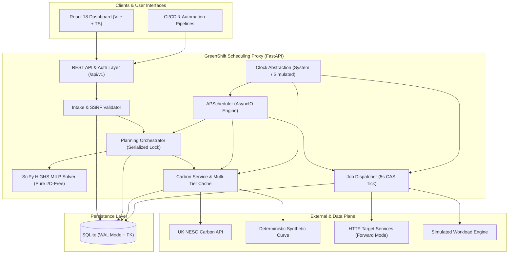

# GreenShift (EcoThrottle)

<div align="center">

[](https://sdgs.un.org/goals/goal13)
[](https://www.python.org/)
[](https://fastapi.tiangolo.com/)
[](https://scipy.org/)
[](https://react.dev/)
[](https://www.typescriptlang.org/)
[](https://vitejs.dev/)
[](https://www.sqlite.org/)

**Intelligent, carbon-aware job scheduling proxy that shifts flexible cloud workloads to clean energy windows without violating SLAs.**

[Features](#-key-features) • [Architecture](#-system-architecture) • [Quickstart](#-quickstart) • [Mathematical Model](#-mathematical-optimization-model) • [API Tour](#-api-tour) • [Documentation](#-project-governance--documentation)

</div>

---

## 🌍 The Problem & The Mission

Cloud and high-performance compute (ML model training, batch analytics, video rendering, data pipelines) consume massive electricity from regional power grids. Grid carbon intensity ($\text{gCO}_2\text{e/kWh}$) fluctuates dramatically within any 24-to-48-hour cycle depending on wind, solar, and fossil-fuel peaker generation.

Most automated workflows execute immediately upon submission—often during peak fossil-fuel generation windows—even when the workload is time-flexible and has hours of allowable slack before its completion deadline.

**GreenShift** resolves this by operating as an intelligent scheduling proxy:
1. Client pipelines submit compute workloads with an estimated duration, power profile, and strict completion deadline.
2. GreenShift evaluates live regional grid carbon intensity and rolling 48-hour forecasts (UK NESO API or offline mock curves).
3. A pure Mixed-Integer Linear Programming (MILP) solver places each workload in the cleanest grid window that satisfies deadline, priority, and cluster power constraints.
4. Explanations and counterfactual avoided emissions are computed deterministically without black-box models.

---

## ✨ Key Features

- 🧠 **Pure Mathematical MILP Optimization:** Uses SciPy's HiGHS solver to minimize total grid emissions ($\sum P \times \Delta t \times I(t)$) subject to hard cluster capacity limits and strict deadline feasibility.
- ⚡ **Multi-Tier Carbon Abstraction:** Real-time UK National Energy System Operator (NESO) API client paired with an offline deterministic mock provider and multi-tier staleness fallback ladder (`ok` $\to$ `degraded` $\to$ fail-safe `unavailable` ASAP).
- 🕒 **Turnkey Accelerated Demo Mode:** Decoupled `Clock` abstraction supporting accelerated simulated time (default 120x; 288x "day-in-5-minutes" preset) enabling end-to-end demonstrations without waiting hours or spending cloud resources.
- 🛡️ **Enterprise Security & SSRF Protection:** Multi-stage DNS/IP resolution filtering private, loopback, and link-local ranges; at-rest AES-128-CBC (Fernet) header encryption; Argon2 password hashing; JWT authentication.
- 🔄 **Atomic Lifecycle & CAS Claim Loops:** Compare-and-Set (CAS) atomic transitions enforce exactly-once job execution in SQLite WAL mode with full event auditing.
- 📊 **Signature 48-Hour Carbon Heatmap:** React 18 + Tailwind SPA displaying interactive 48-hour carbon timelines with workload lane packing, grid status, and exportable analytics.
- 🎯 **Transparent Explanations & Integrity:** Deterministic template-driven reason codes for every schedule decision; honest labelling of *forecast-based* vs. *realized* emissions.

---

## 🏗 System Architecture

GreenShift is built as a modular monolith running in a single Python 3.12 process backed by SQLite in WAL mode:



---

## 🚀 Quickstart

### Prerequisites
- **Python:** 3.12+ (or [uv](https://github.com/astral-sh/uv))
- **Node.js:** 20+ (with npm 10+)
- **Git**

### 1. Clone & Set Up

```bash
git clone https://github.com/the-fahyan/EcoThrottle.git
cd EcoThrottle
```

### 2. Configure Environment

Copy the comprehensive reference environment configuration:

```bash
cp .env.example .env
```

### 3. Install & Verify Quality Gate

GreenShift provides unified targets for cross-platform execution (Linux/macOS `make`, Windows `make.bat` or `make`):

```bash
# Install backend virtualenv (via uv) and frontend dependencies
make install

# Execute the complete quality gate (linters, typecheckers, unit tests, frontend build)
make check
```

### 4. Start Development Servers

In terminal 1 (Backend API on `http://localhost:8000`):
```bash
make backend-dev
```

In terminal 2 (Frontend Dashboard on `http://localhost:5173`):
```bash
make frontend-dev
```

Visit the interactive API docs at `http://localhost:8000/docs` and the Dashboard at `http://localhost:5173`.

---

## 🧮 Mathematical Optimization Model

GreenShift optimizes workload placement over a rolling 48-hour horizon ($S = 96$ slots of $\Delta t = 0.5$ hours).

### Objective Function

$$\min_{x} \sum_{j \in J} \sum_{s \in \mathcal{F}_j} x_{j,s} \cdot \left[ E_j \cdot \bar{I}_{j,s} + \lambda_{\text{prio}}(p_j) \cdot \Delta t \cdot s \cdot E_j \right] + \epsilon \cdot \text{TieBreaker}$$

Where:
- $x_{j,s} \in \{0, 1\}$ is 1 if job $j$ starts in slot $s$, 0 otherwise.
- $E_j = \text{power\_kw}_j \times \text{duration\_hours}_j$ (Energy in kWh).
- $\bar{I}_{j,s}$ is the average carbon intensity ($\text{gCO}_2/\text{kWh}$) over the job's span starting at slot $s$.
- $\lambda_{\text{prio}}$ applies a dimensional penalty ($g\text{CO}_2e$) balancing carbon savings against job priority and delay.
- $\epsilon \cdot \text{TieBreaker}$ provides deterministic, zero-jitter placement for identical inputs.

### Hard Constraints

1. **Exactly-Once Placement:** $\sum_{s \in \mathcal{F}_j} x_{j,s} = 1 \quad \forall j \in J$
2. **SLA Deadlines:** $\mathcal{F}_j = \{ s \mid s \ge s_j^{\text{earliest}} \text{ and } s + d_j \le s_j^{\text{deadline}} \}$
3. **Cluster Power Limit:** $\sum_{j \in J} \sum_{u=0}^{d_j-1} x_{j, s-u} \cdot \text{power\_kw}_j \le P_{\text{cluster}} \quad \forall s$

---

## 📡 API Tour

### 1. Workload Intake (`POST /api/v1/jobs`)

```bash
curl -X POST http://localhost:8000/api/v1/jobs \
  -H "Content-Type: application/json" \
  -H "Authorization: Bearer <TOKEN>" \
  -d '{
    "name": "daily-ml-fine-tuning",
    "duration_minutes": 120,
    "power_kw": 15.0,
    "deadline_at": "2026-10-15T18:00:00Z",
    "priority": "normal",
    "execution_type": "simulated"
  }'
```

### 2. Schedule Preview (`POST /api/v1/jobs/preview`)

Simulates optimal scheduling without inserting the job into the queue, returning counterfactual carbon savings, delay hours, and decision reason codes:

```json
{
  "recommended_start_at": "2026-10-15T02:00:00Z",
  "baseline_emissions_g": 3840.5,
  "optimized_emissions_g": 1920.2,
  "savings_percent": 50.0,
  "reason_code": "CLEANER_WINDOW",
  "explanation": "Shifted by 6.0h into cleaner overnight wind generation window (64 gCO2/kWh vs 128 gCO2/kWh baseline)."
}
```

---

## 📋 Available Commands

| Command | Description |
|---|---|
| `make install` | Installs Python 3.12 dependencies into `.venv` and Node modules into `frontend/` |
| `make check` | Runs full quality check: backend lint, backend test, frontend lint, frontend test, frontend build |
| `make backend-lint` | Runs Ruff and mypy strict checks across `backend/` |
| `make backend-test` | Runs pytest with full branch coverage measurement |
| `make frontend-lint` | Runs ESLint with zero-warning threshold |
| `make frontend-test` | Runs Vitest unit and smoke test suites |
| `make frontend-build` | Builds production-optimized frontend bundle into `frontend/dist/` |
| `make backend-dev` | Launches FastAPI backend with hot reloading on port 8000 |
| `make frontend-dev` | Launches Vite frontend dev server on port 5173 |

---

## 🏛 Project Governance & Documentation

EcoThrottle follows a strict governing authority order and verifiable milestone gates:

1. **[docs/PRD.md](file:///g:/work%20space/EcoThrottle/docs/PRD.md):** Authoritative 20-section Product Requirements Document (v1.1).
2. **[prd-addendum.md](file:///g:/work%20space/EcoThrottle/prd-addendum.md):** Architectural derivations and permanent Architectural Decision Record (ADR) log.
3. **[implementation-plan.md](file:///g:/work%20space/EcoThrottle/implementation-plan.md):** 18-milestone implementation roadmap.
4. **[build-progress.md](file:///g:/work%20space/EcoThrottle/build-progress.md):** Single persistent record of verified progress and test evidence.
5. **[build-rule.md](file:///g:/work%20space/EcoThrottle/build-rule.md):** Operational and behavioral specification for AI build agents.
6. **[AGENTS.md](file:///g:/work%20space/EcoThrottle/AGENTS.md):** Antigravity agent startup protocol and lifecycle hooks.

---

## 📄 License

This project is licensed under the [MIT License](LICENSE).
Aligned with **United Nations Sustainable Development Goal 13: Climate Action**.
